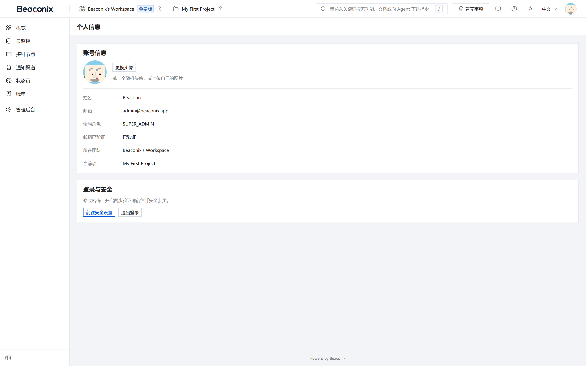
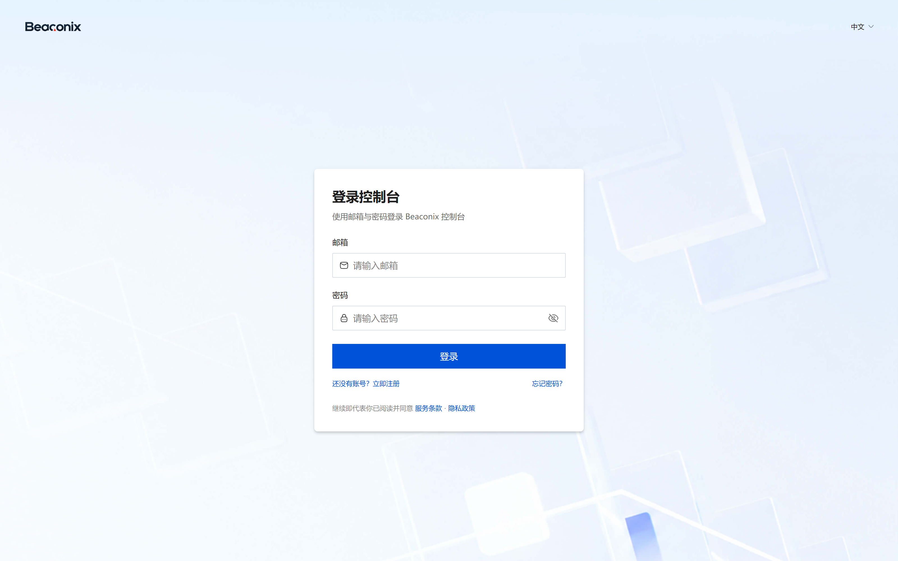

# 账号与身份认证

## 用户注册与邮箱验证

本系统采用邮箱注册，注册与验证分为两个环节，未通过邮箱验证的账号不能完成登录后的完整操作。

注册时用户提交邮箱与口令，系统校验邮箱格式与唯一性、口令强度后创建账号，同时生成 6 位数字验证码并发送至该邮箱。验证码具有有效期与使用次数限制，短期内重复索取验证码会被拒绝，以防止验证码接口被滥用。

用户提交邮箱与验证码后，系统在同一个数据库事务中完成两件事：标记邮箱已验证，以及为该用户开通默认组织。开通逻辑具备幂等性——如果用户已经属于任何组织，则跳过创建，因此重复提交验证不会产生重复组织。开通时系统自动将用户设为该组织的所有者，写入对应的成员关系，并创建该组织的第一个项目，使用户登录后即可直接使用，无需额外配置。

若验证码丢失或过期，用户可以请求重新发送。重新发送受频率限制，且旧验证码在有效期内依然可用，避免因重发导致正在填写的验证码失效。

## 用户登录与令牌管理

用户以邮箱与口令登录。系统校验口令后签发两类令牌：访问令牌与刷新令牌。访问令牌有效期较短，用于业务接口鉴权；刷新令牌有效期较长，仅用于换取新的访问令牌。

刷新采用轮换机制：每次刷新都会签发新的刷新令牌并使旧令牌立即失效。这样即使刷新令牌被截获，攻击者与合法用户也只有一方能继续刷新，异常会以另一方被强制登出的形式暴露。系统记录每个刷新令牌的签发时间、过期时间与关联设备信息，登出时将与当前会话对应的刷新令牌标记为失效；用户修改口令后，其全部历史刷新令牌一并失效，强制所有设备重新登录。

已启用双因素认证的账号在口令校验通过后不会立即获得访问令牌，而是先获得一次性的挑战凭据，须再提交动态口令或恢复码方可完成登录，详见 4.4 节。

## 密码找回与修改

忘记口令时，用户提交注册邮箱，系统生成验证码并发送邮件。校验验证码通过后，用户可设置新口令，系统随即使该账号的全部历史刷新令牌失效，并向账号邮箱与站内通知推送口令变更提醒，使账号所有者在口令被他人重置时能够察觉。

已登录用户可在个人信息中修改口令，修改时须提供当前口令。修改成功后同样使历史刷新令牌失效，并触发站内通知。口令在数据库中仅保存单向散列值，不可逆推。

## 双因素认证

系统支持基于时间的一次性口令（TOTP）双因素认证，与常见身份验证器应用兼容。完整流程如下。

1. **绑定**。用户发起绑定时，系统生成密钥与对应的绑定二维码，同时返回密钥文本以便手工录入。此时双因素尚未生效，用户需提交一次正确的动态口令以证明绑定成功。
2. **启用**。校验通过后启用双因素，并一次性生成一组恢复码返回给用户。恢复码以散列形式存储，界面仅显示一次，用于动态口令不可用时登录。
3. **登录校验**。已启用双因素的账号在口令校验通过后进入挑战状态，系统返回挑战凭据并提示输入动态口令。用户提交动态口令或任一未使用的恢复码后完成登录；恢复码使用后立即作废，系统同时提示剩余数量并推送通知。
4. **重新生成恢复码**。用户可在验证身份后重新生成一组恢复码，旧恢复码全部作废。
5. **关闭双因素**。关闭操作须通过动态口令或恢复码验证，关闭后登录流程恢复为单因子。

系统对启用、关闭、使用恢复码、重新生成恢复码等关键动作均记录审计并推送站内通知，便于账号所有者及时发现非本人操作。

## 第三方登录

系统对接微信生态的多种登录方式，微信身份与本地账号通过身份实体关联，一个本地账号可绑定多个第三方身份。

- **网页授权登录**。系统提供授权地址生成能力与授权码换取登录结果的接口，适用于浏览器端。
- **小程序登录**。小程序端提交登录凭证，系统换取微信侧身份标识并完成登录或首次注册。
- **扫码登录**。桌面端展示登录二维码，用户使用移动端扫码确认；桌面端轮询二维码状态，依次经历待扫描、已扫描、已确认三个阶段，确认后取得登录令牌。二维码具有有效期，过期后需重新生成。

第三方登录成功后的令牌签发规则与口令登录一致；若账号已启用双因素认证，第三方登录同样需要完成双因素校验，避免绕过。

## 个人信息管理

用户可查询本人资料，包含标识、邮箱、昵称、头像、邮箱验证状态、双因素启用状态与所属组织列表；可修改昵称与头像等非敏感资料；可修改口令。个人资料接口不接受角色、组织归属等权限相关字段的写入，这些字段只能通过成员管理与组织所有权转移流程变更。

个人资料页（图 4-2）展示上述信息，并提供昵称与头像修改入口；页面同时给出所属组织列表与切换入口。

## 会话与安全策略

- 访问令牌与刷新令牌均设置有效期，过期后必须重新认证或刷新。
- 登录失败与验证码索取均受频率限制，防止口令爆破与短信邮件轰炸。
- 系统处于维护模式时，除认证与健康检查外的写操作会被拒绝，并返回明确的维护提示。
- 全部认证类接口的调用结果（成功与失败）均记录来源地址与调用时间，用于事后排查。
- 账号被停用后，其全部令牌在下次校验时即被拒绝，无需等待过期。

## 登录与控制台入口

系统配套提供 Web 控制台，通过浏览器访问控制台地址即可进入登录页。登录页由品牌区、登录卡片（邮箱与密码输入、登录按钮）、注册与找回密码入口、服务条款与隐私政策提示组成，右上角支持界面语言切换。

登录成功后进入控制台主界面。主界面分为三个区域：顶部为全局功能搜索、通知入口、语言切换与个人菜单；左侧为功能导航，包含概览、云监控、探针节点、通知渠道、状态页、账单与管理后台；主区为当前页面的内容。控制台的全部操作最终通过第 3 章所述的接口完成，界面本身不引入额外的业务规则，因此控制台与第三方集成方使用的是同一套能力。

