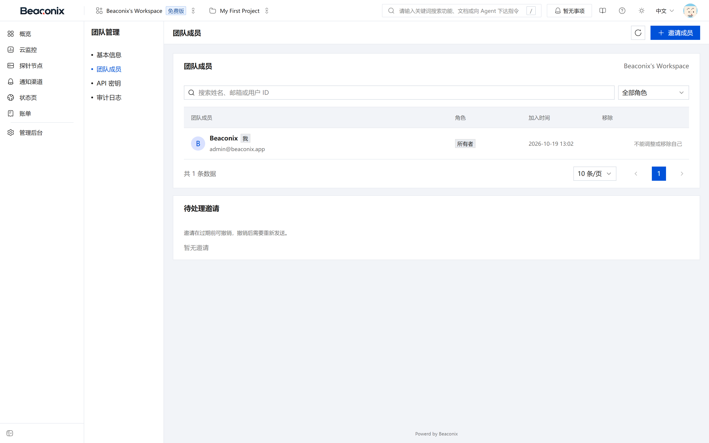
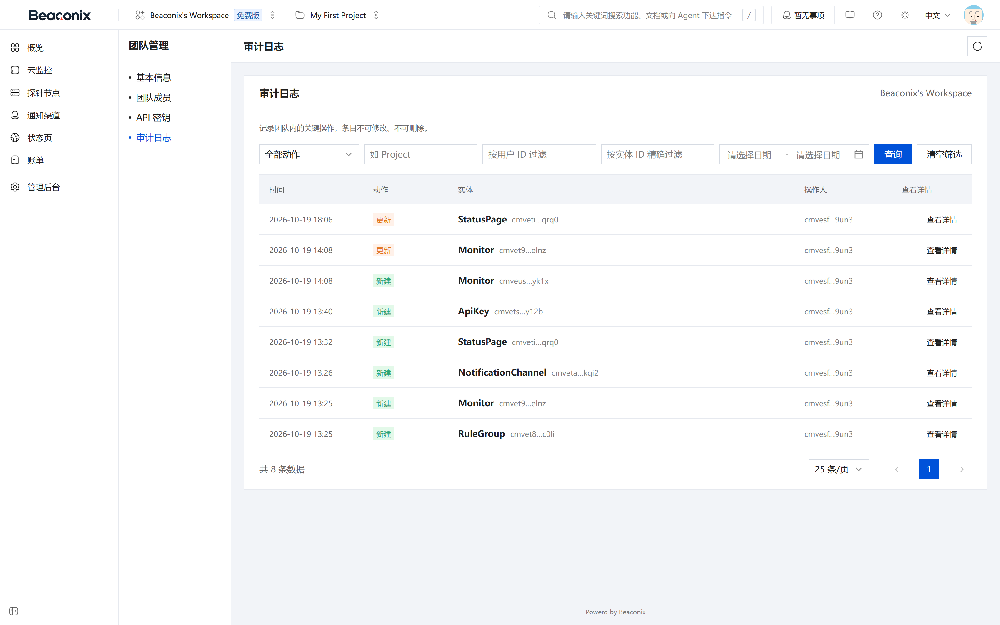

# 组织、成员与权限

## 组织管理

组织是本系统的租户单元，也是所有业务数据、成员与配额的归属边界。用户在完成邮箱验证时自动获得一个组织，除此之外还可以加入其他组织或自行创建新组织，并在多个组织之间切换。

用户可执行的操作如下：

- **创建组织**。提交组织名称与描述即可创建。创建者自动成为该组织的所有者，并写入对应的成员关系。组织名称在平台内不要求全局唯一，但同一用户不可创建重名组织。
- **查看组织列表**。返回当前用户所属的全部组织，包含组织标识、名称、角色、成员数量与创建时间，用于组织切换。
- **查看组织详情**。返回组织基本信息、当前用户在该组织中的角色、配额使用情况与关键统计。
- **修改组织信息**。所有者与管理员可修改组织名称、描述与标识性配置。
- **转移所有权**。所有者可将所有权转移给组织内的其他成员。转移后原所有者降为管理员，新所有者获得全部所有者权限。转移操作需二次确认并记录审计。
- **删除组织**。仅所有者可删除组织。删除采用软删除，组织及其下资源被标记删除时间，成员立即失去访问权限；在保留期内可由管理员角色通过恢复入口恢复，超过保留期后由定时任务清理。

组织标识在接口路径中以参数形式出现，是后续所有资源访问的租户依据。系统在每次请求中依据该标识校验成员资格，因此组织标识不能伪造，也不存在"仅凭资源标识访问跨组织资源"的路径。

## 成员管理

成员是用户与组织之间的关联，携带角色信息，是权限判定的直接依据。

成员列表展示全部成员的用户标识、昵称、邮箱、角色、加入时间与状态，支持按角色与关键字筛选，支持分页。列表对所有成员可见，便于协作时确认责任人。

成员管理操作及权限要求如下：

表 5-1 成员操作与权限

| 操作 | 说明 | 最低角色要求 |
| --- | --- | --- |
| 查看成员列表 | 查询组织内成员及角色 | 观察者 |
| 调整成员角色 | 修改指定成员的角色 | 管理员 |
| 移出成员 | 将指定成员移出组织，同时清理其项目成员关系 | 管理员 |
| 主动退出组织 | 成员自行退出 | 该成员本人 |
| 转移所有权 | 将所有者身份转给他人 | 所有者 |

角色调整遵循两条约束：一是操作者的角色等级必须高于目标角色，管理员不能把他人提升为所有者，也不能修改同级或更高级别的成员；二是所有者角色具有唯一性，只能通过所有权转移改变，不能直接授予或撤销。

成员被移出组织后，其全部刷新令牌依然有效（该用户可能还属于其他组织），但其对本站组织的任何请求都会被拒绝；系统同时解除该用户与本组织项目的成员关系，并推送通知告知双方。

## 角色与权限模型

### 组织级角色

系统设置四级组织角色，按权限由高到低依次为所有者、管理员、成员、观察者。角色采用等级下限匹配：接口声明所需的最低等级，成员角色等级不低于该值即可访问。

表 5-2 组织角色与权限范围

| 角色 | 等级 | 权限范围 |
| --- | --- | --- |
| 所有者 | 4 | 组织全部权限，含组织删除、所有权转移、成员与计费管理 |
| 管理员 | 3 | 除组织删除与所有权转移外的管理权限，含成员管理、邀请、配置管理 |
| 成员 | 2 | 业务数据的创建与修改，含项目、迭代、任务、监控与告警配置 |
| 观察者 | 1 | 只读访问，可查看数据但不可创建、修改或删除 |

系统另设平台级超级管理员角色，仅用于平台自营管理后台，不参与组织内权限判定。超级管理员可跨组织访问管理类接口，其全部操作单独记录审计。

### 项目级权限

在组织角色之外，系统对项目级资源（监控目标、告警规则、状态页等）提供更细粒度的访问控制，形成第二套并行的授权通道。

- **项目成员**。组织成员可被加入具体项目并赋予项目角色，项目角色决定其在该项目内的可操作范围。
- **资源授权**。在项目成员基础上，还可对单个资源（如某个监控目标、某个规则组）配置授权，将访问范围收敛到具体对象。
- **我的权限查询**。接口返回当前用户在指定组织或项目下的有效权限集合，供客户端决定界面元素的可见与可用状态，避免"能点但被拒绝"的体验问题。
- **成员项目权限配置**。管理员可查询并设置指定成员在各项目中的权限，一次提交完成批量调整。

两套模型的适用边界明确：组织、成员、邀请、计费、凭据与管理后台等租户级资源只走组织角色判定；项目、监控、规则、状态页等项目级资源走项目授权判定。同一资源族不会同时叠加两套语义冲突的判定，避免出现"组织角色允许但项目授权拒绝"的歧义。

## 邀请机制

组织成员通过邀请加入，系统不提供"凭邮箱直接添加成员"的通道，以保证被邀请人知情且同意。

邀请的发起与流转如下：

1. **发起邀请**。管理员填写被邀请人邮箱、授予的角色，可选指定其加入后自动获得权限的项目。系统生成一次性邀请令牌并发送邀请邮件，邮件中包含可直接接受的链接。同一邮箱存在未过期邀请时，重复发起将被拒绝或用新邀请替代旧邀请。
2. **查看待处理邀请**。受邀用户登录后可查看发给自己的全部未处理邀请，包含组织名称、邀请人、角色与有效期。
3. **接受邀请**。接受时系统校验令牌有效性、邮箱匹配与有效期，通过后在事务中写入成员关系、项目授权，并使邀请失效。若该用户已是组织成员，则仅补充项目授权。
4. **拒绝邀请**。拒绝后邀请失效，邀请人收到通知。被拒绝的邀请不可再次使用，需要重新发起。
5. **撤销邀请**。管理员可在邀请被接受前撤销，撤销后令牌立即失效。
6. **过期处理**。邀请具有有效期，到期未处理的邀请由定时任务批量置为过期状态，并向邀请人与受邀人推送通知。

邀请状态包括待处理、已接受、已拒绝、已撤销、已过期五种，状态单向流转，已结束的邀请不回到待处理状态。

## 组织设置与公共配置

系统设置分为平台级与组织级两类。平台级设置由超级管理员维护，包含注册开关、维护模式、邮件与支付相关参数、功能开关等，其中一部分被标记为公开设置，可被未登录用户读取，用于客户端决定是否展示注册入口等。

组织级设置由组织管理员维护，包含组织的展示信息、通知偏好等。组织设置只影响本组织的业务行为，不改变平台级开关。

设置项以键值形式存储，值具有明确类型（字符串、数字、布尔、结构化数据），写入时按声明的类型校验，读取时按类型还原，避免将字符串"false"当作布尔真值这类问题。设置变更记录审计，公开设置的读取不带敏感字段。

## 成员与审计界面

控制台的成员管理页面以表格呈现组织全部成员，列出昵称、邮箱、角色、加入时间与状态，并支持按角色筛选与关键字搜索；行内提供角色调整与移出操作，操作入口按当前用户的角色等级动态显示，等级不足时不展示对应按钮，从源头减少无效操作。

审计日志页面按时间倒序展示组织内的写操作记录，列出操作者、操作类型、目标实体、来源地址与时间，支持按实体类型、操作类型与时间区间筛选；点击单条记录可查看变更前后的字段对比。

