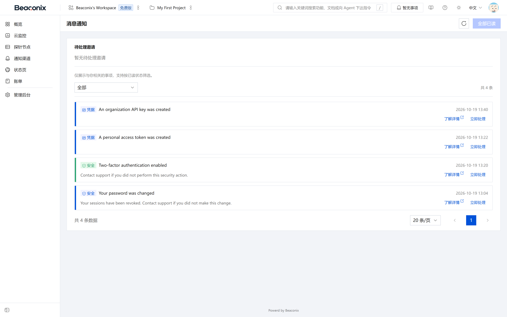

# 敏捷项目协作

协作工作区是本系统承载监控目标组织与告警处置流程的载体。项目为监控目标、任务与迭代提供归属，任务可用于记录故障处置过程，站内通知与审计日志则贯穿全过程。

## 项目管理

项目是组织内的业务分组单元，每个组织可创建多个项目。项目的基本操作如下。

- **创建项目**。提交项目名称、描述与项目标识键。标识键为 2 至 10 位大写字母或数字，用于生成可读的任务编号；标识键在同一组织内唯一，不同组织可取相同标识键。
- **查看项目列表**。返回组织内全部项目，包含名称、标识键、状态、成员数量、监控数量与任务统计，支持分页与关键字筛选。
- **查看项目详情**。返回项目基本信息、成员列表、统计信息与最近活动。
- **修改项目**。可修改名称、描述等元信息，修改记录审计。
- **归档项目**。归档后项目转为只读状态，其中不可新建或修改任务、不可调整监控配置，但数据可查询。归档操作推送通知给项目成员。
- **恢复项目**。将已归档项目恢复为正常状态。
- **删除项目**。采用软删除，删除后项目及其下资源对成员不可见；在保留期内可恢复，超过保留期由定时任务清理。

项目级访问控制遵循第 5 章的授权模型：组织成员需被加入项目或获得资源授权，才能对项目内资源执行写操作。

## 迭代管理

迭代（Sprint）是项目内的时间盒，用于组织一段时间内计划完成的任务，具备明确的生命周期。

表 6-1 迭代状态流转

| 当前状态 | 可执行操作 | 目标状态 | 说明 |
| --- | --- | --- | --- |
| 计划中 | 启动迭代 | 进行中 | 同一项目同时只允许一个进行中的迭代 |
| 计划中 | 删除 | —— | 计划中的迭代可直接删除，其任务回到待办池 |
| 进行中 | 完成迭代 | 已完成 | 未完成任务可选择移回待办池或顺延至下一迭代 |
| 已完成 | 删除 | —— | 已完成迭代保留历史，删除需显式确认 |

迭代操作要点：

- **创建迭代**。提交名称、目标、起止日期，创建后状态为计划中。
- **调整顺序**。同项目内的迭代可调整排序，排序结果影响列表展示与下一迭代的判定。
- **启动迭代**。启动后状态变为进行中，系统推送迭代启动通知给项目成员。
- **完成迭代**。完成后统计完成率与故事点，未完成任务的处理方式由操作者选择；系统推送迭代完成通知。
- **查看迭代**。返回迭代信息、任务清单与统计。

## 任务管理

任务是项目内的工作项，本系统对其提供完整的生命周期管理。

### 任务字段

任务包含标题、描述、状态、优先级、故事点、指派人、所属迭代、父任务、截止时间、开始时间与标签等字段。状态取值覆盖待处理、进行中、待验证、已完成与已取消等阶段；优先级覆盖最低、低、中、高、紧急五档。

### 任务操作

- **创建任务**。提交标题与所属项目即可创建，其余字段可选。若指定父任务，则创建为子任务，子任务继承父任务的迭代归属；若指定迭代，任务直接进入该迭代，否则进入待办池。
- **查看任务**。返回任务全部字段、父子关系、依赖关系、关注状态、标签、评论数与活动数。
- **更新任务**。可修改任意业务字段，修改行为触发活动记录与关注者通知。状态变更、指派人变更、迭代变更分别产生对应类型的通知。
- **指派与转派**。将任务指派给项目成员。指派前校验被指派人对项目的访问权限，避免将任务指派给无权查看该任务的人员。
- **移动任务**。在待办池与各迭代之间移动任务，或在迭代之间移动。移动同时更新任务归属并记录活动。
- **删除与恢复**。删除采用软删除，删除后任务从列表与统计中移除；在保留期内可通过恢复操作还原。删除与恢复均通知关注者。
- **查询任务列表**。支持按项目、迭代、状态、优先级、指派人、标签、关键字与时间区间组合筛选，支持按创建时间、更新时间、优先级与截止时间排序，支持分页。
- **查询待办池**。单独提供待办池视图，返回未进入任何迭代的未完成任务，按优先级与创建时间排序，供迭代规划使用。

### 子任务与层级

任务可设置父任务形成两级以上的层级结构。父任务的状态不随子任务自动变更，但父任务详情会汇总子任务的完成情况，供使用者判断整体进度。删除父任务时，其子任务一并软删除。

## 任务依赖与关注

### 依赖关系

任务之间可建立阻塞关系，表达"某任务须在另一任务完成后才能开始"。

- **建立依赖**。为任务添加被阻塞任务，系统校验不构成环路，环路依赖会被拒绝并返回明确提示。
- **解除依赖**。删除指定依赖关系。
- **解除阻塞通知**。当阻塞该任务的其他任务全部完成时，系统判定该任务解除阻塞，并向指派人推送通知，提示可以开始处理。

### 关注

用户可关注或取消关注任意可访问的任务。关注者在任务发生状态变更、指派变更、评论、被解除阻塞、删除与恢复时接收通知。创建任务、被指派任务与发表评论的用户自动成为关注者，无需手动关注。

## 任务活动日志

任务的全部关键变更自动形成活动记录，构成任务时间线。每条记录包含操作者、动作类型、发生时间，以及变更字段的旧值与新值。

活动类型包括创建、状态变更、指派变更、优先级变更、迭代变更、截止时间变更、依赖变更、评论、附件变更、标签变更、关注变更、删除与恢复。活动记录只追加不修改，作为任务处置过程的原始凭据；活动列表按时间倒序分页返回。

## 评论

任务是评论的宿主，评论用于讨论与处置过程记录。

- **发表评论**。提交正文即可发表。正文支持提及组织成员，被提及者收到提及通知。
- **多级回复**。评论可指定父评论形成嵌套结构，形成围绕具体问题的讨论串；回复时通知被回复者与父评论作者。
- **编辑评论**。作者可编辑自己的评论，编辑后保留编辑标记与时间。
- **删除评论**。采用软删除，作者本人与管理员可删除。删除后其子回复一并隐藏，但底层记录保留以便追溯。

评论列表按时间正序返回，支持分页；每条评论包含作者、正文、创建时间、编辑状态与子回复。

## 附件

附件用于为任务保存截图、日志、配置文件等证据材料。系统提供两种附件形态。

- **上传附件**。以表单方式上传文件，系统校验文件大小与扩展名白名单，落盘或转存至对象存储后写入附件元数据，返回附件标识与访问地址。附件记录包含原始文件名、大小、类型、存储方式、可见性与上传人。
- **外链附件**。登记一个外部地址作为附件，适用于文件已在其他系统的场景。系统仅保存链接与元数据，不转存内容。
- **下载附件**。按附件标识返回文件流或访问地址；受限于可见性设置的附件需要有效凭证方可访问。
- **删除附件**。删除附件记录并按策略清理存储文件；超过保留期的孤儿文件由定时任务统一清理。

附件上传接口对单个文件与单次请求总量均设上限，超出时返回明确错误。附件内容不参与审计快照，审计仅记录附件元数据变更。

## 标签

标签用于对任务做横向分类，支持组织级与项目级两个作用域。

- **创建标签**。提交名称与颜色。组织级标签对组织内全部项目可见，项目级标签仅对所属项目可见。
- **修改与删除标签**。可修改名称与颜色；删除标签会同步解除其与全部任务的关联，任务本身不受影响。
- **任务打标与取消**。为任务添加或移除标签，同一任务对同一标签不可重复添加。
- **按标签筛选**。任务列表支持按一个或多个标签筛选，多个标签之间取交集。

## 通知中心

通知中心承担系统内全部事件的消息送达，覆盖站内与外部两条通道。

### 通知类型

通知按业务场景分类，包含任务类（指派、更新、评论、状态变更、临期、逾期、解除阻塞、删除与恢复、迭代变更、依赖变更）、迭代类（启动、完成、删除）、项目类（归档、删除、恢复）、成员类（加入、移出、角色变更、主动退出、所有权转移）、邀请类（收到、接受、拒绝、撤销、过期）、组织类（删除、恢复）、账号安全类（口令变更、口令重置完成、双因素启用与关闭、恢复码使用与重生成）、计费类（支付成功、订阅激活、续费、即将到期、已到期）、监控类（告警、恢复）、凭据类（接口凭据创建与吊销、个人令牌创建与吊销、探针注册与密钥轮换）、工单类（创建、回复、状态变更、指派）。

每条通知包含类型、标题、正文、关联资源标识、是否为已读与创建时间；接收人按通知类型对应的规则计算，如任务类通知发给指派人、关注者与提及者，成员类通知发给组织管理员。

### 站内通知操作

- **通知列表**。按时间倒序返回当前用户的通知，支持按已读状态与类型筛选，支持分页。
- **未读数量**。返回当前用户的未读通知总数，供界面角标展示。
- **标记已读**。支持单条标记与一键全部标记。
- **删除通知**。删除单条通知，删除后不再出现在列表中。
- **实时推送**。系统提供长连接通道，通知产生时即时推送给在线客户端；连接断开后客户端自动重连，重连期间产生的通知通过列表接口补齐，不会丢失。

### 外部投递

需要外部送达的通知（主要是邮件与告警类消息）通过投递记录跟踪：每次投递生成一条记录，包含通道、目标、状态、失败原因与重试次数。投递失败按策略重试，重试仍失败则标记为最终失败并保留记录供人工排查；告警类投递支持手动重试。

控制台的通知中心页面（图 6-1）按时间倒序展示通知，顶部显示未读数量，支持按已读状态与类型筛选，提供单条标记已读、一键全部标记已读与删除操作；点击通知可跳转到关联的任务或监控。

## 审计日志

审计日志记录系统中全部写操作，作为变更追溯与合规审计的依据。

- **采集方式**。控制器方法声明审计实体后，框架自动推断操作类型（创建、更新、删除），在业务执行前抓取实体变更前快照，在响应返回后抓取变更后快照，写入操作者、来源地址、请求方法与路径。
- **脱敏规则**。口令、令牌、密钥类字段在写入前替换为掩码，审计日志中不出现可用于认证的敏感值。
- **异步写入**。审计写入与业务响应解耦，审计失败不会导致业务请求失败，也不会阻塞响应。
- **查询**。按组织查询审计日志，支持按实体类型、操作类型、操作者与时间区间筛选，支持分页；单条日志可查看变更前后快照对比。

审计日志只追加不修改不删除，普通成员不可访问，组织管理员可查询本组织日志，平台超级管理员可查询全量日志。
