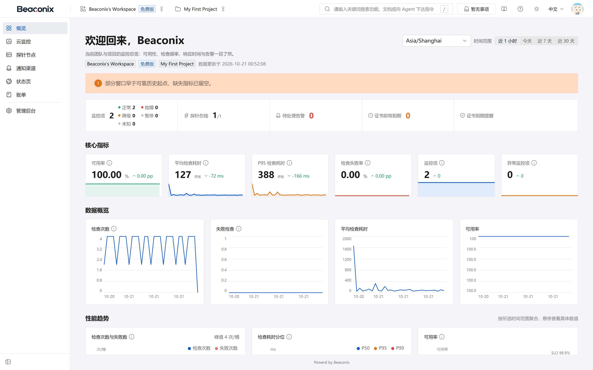
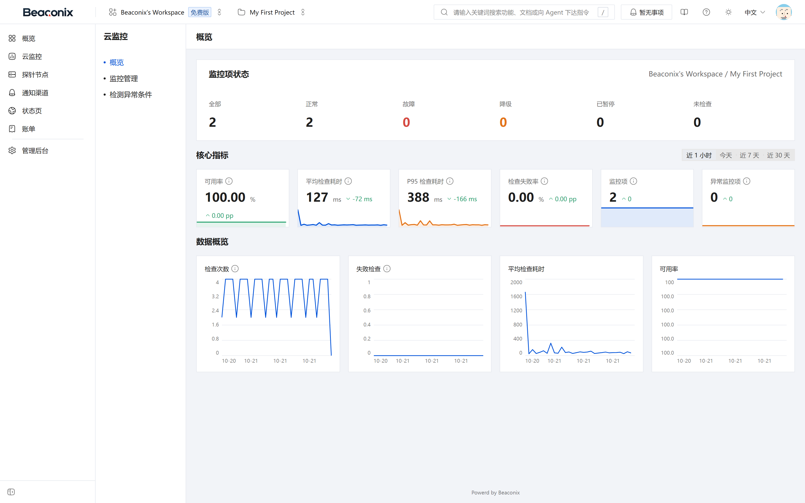
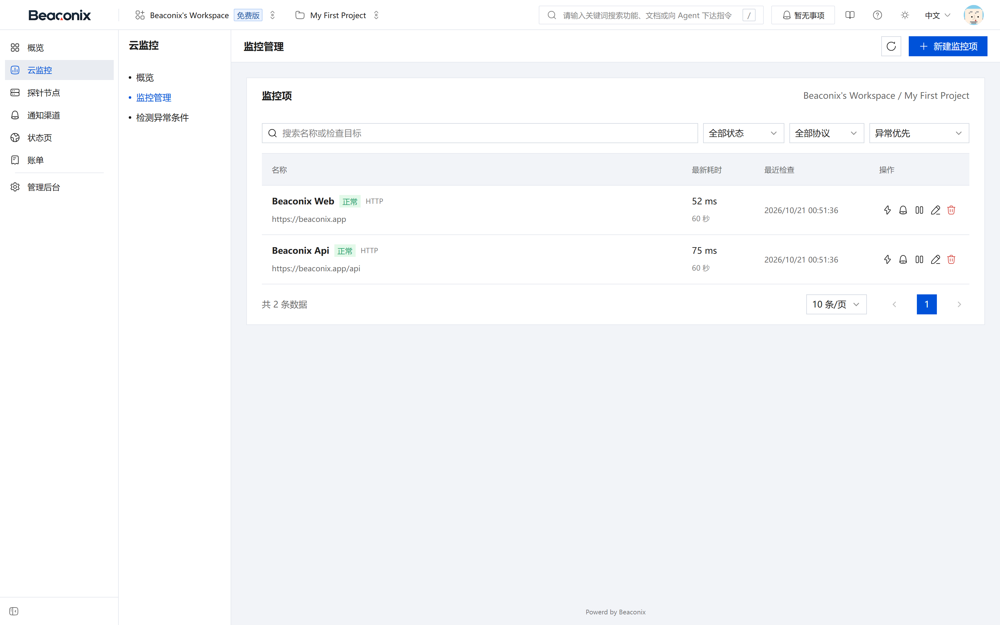
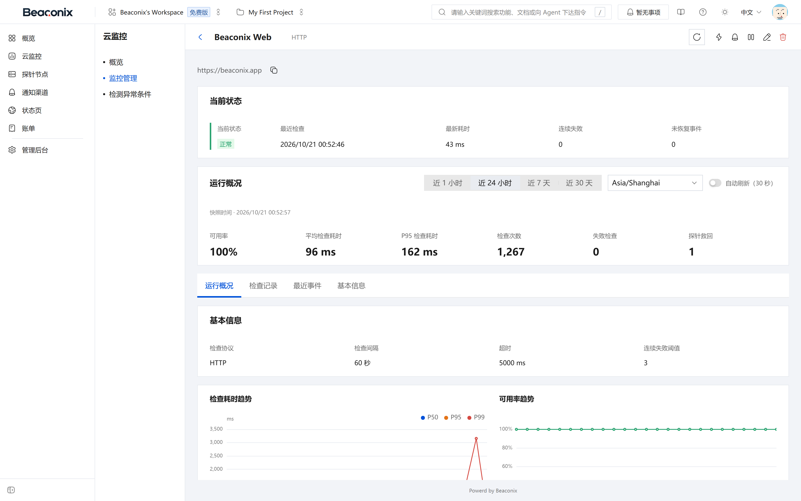
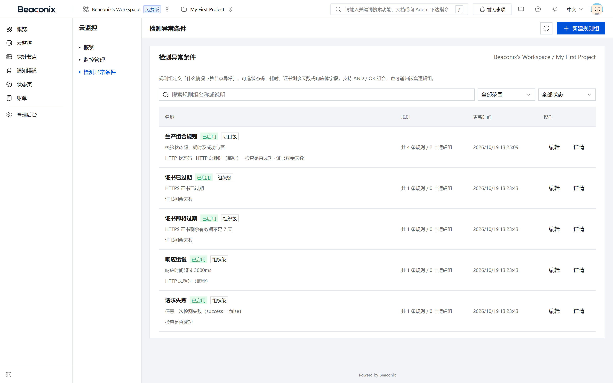
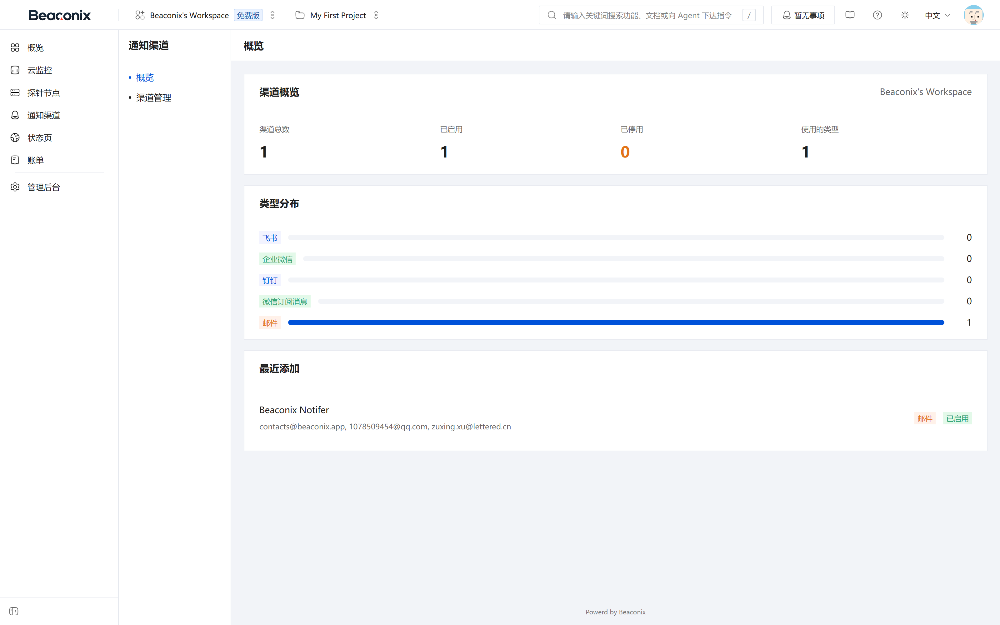
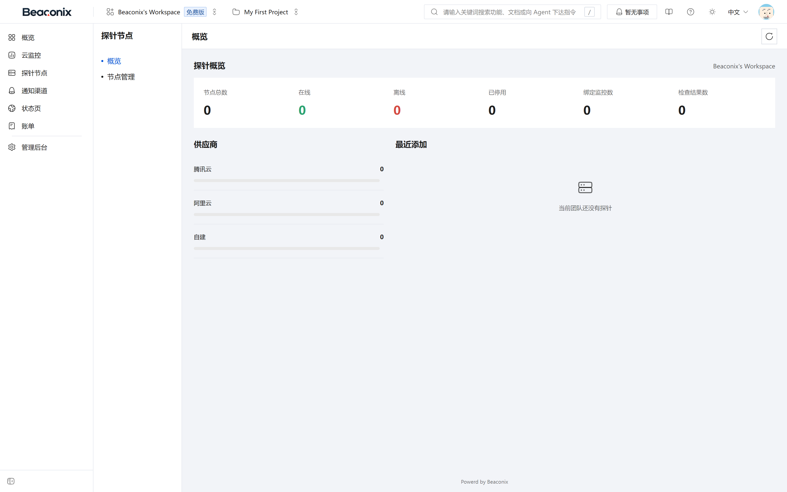
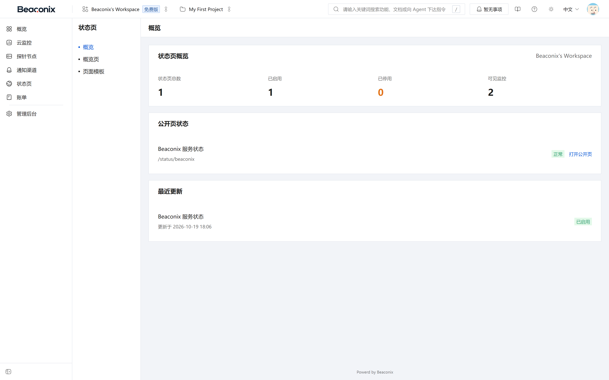

# 可用性监控平台

监控能力是本系统的核心。本章按"配置监控目标—执行检查—判定状态—产生告警—送达通知"的主链路说明各功能模块，并说明分布式探针与公开状态页。

## 监控项管理

监控目标是检查的对象，归属于项目，是监控域的基本配置单元。

### 监控字段

创建监控时需填写名称与目标地址，并选择监控类型、检查周期、超时时间与断言条件；可选绑定一个或多个探针、绑定通知渠道、设置标签与分组。监控记录同时保存当前状态、最近一次检查时间、连续失败次数与创建者信息。

### 监控操作

- **创建监控**。校验目标地址格式与检查周期下限后创建，初始状态为未知，待首次检查后确定。
- **查看监控列表**。按项目返回监控清单，包含名称、类型、当前状态、最近检查时间、响应耗时与标签，支持按状态、类型、名称筛选与分页。
- **查看监控详情**。返回配置项、当前状态、绑定探针、绑定通知渠道与最近若干次检查摘要。
- **修改监控**。可修改除类型外的全部配置；修改检查周期、断言条件或目标地址后，下一轮检查即按新配置执行。
- **暂停与恢复**。暂停后不再参与调度，状态标记为已暂停；恢复后重新纳入调度，状态回到未知并在下一轮检查后更新。暂停不会清空历史数据。
- **删除与恢复**。删除采用软删除，删除后监控从列表与统计中移除，相关绑定关系保留以便恢复；在保留期内可恢复，超过保留期由清理任务删除历史数据。
- **绑定探针**。为监控分配一个或多个探针，分配后该监控由所选探针执行检查；未绑定探针时由服务端本地执行。
- **测试告警**。以当前配置向已绑定的通知渠道发送一条测试消息，用于验证渠道连通性，不产生真实告警事件。

## 多协议检查能力

系统内置 11 类检查器，覆盖常见的可用性探测场景。

表 7-1 检查类型与判定方式

| 类型 | 探测方式 | 主要断言条件 |
| --- | --- | --- |
| HTTP | 发起 HTTP/HTTPS 请求 | 状态码范围、响应时间上限、响应体关键字、响应头取值、JSON 字段取值 |
| TCP | 建立 TCP 连接 | 端口可连接、连接耗时上限 |
| PING | 发送 ICMP 探测 | 可达性、往返时延上限、丢包率 |
| DNS | 域名解析查询 | 解析成功、记录类型与取值匹配、解析耗时上限 |
| MySQL | 建立数据库连接并执行轻量查询 | 连接成功、查询耗时上限、认证与权限可用 |
| PostgreSQL | 建立数据库连接并执行轻量查询 | 连接成功、查询耗时上限、认证与权限可用 |
| Redis | 建立连接并执行只读命令 | 连接成功、命令响应正常、耗时上限 |
| MongoDB | 建立连接并执行轻量查询 | 连接成功、查询耗时上限 |
| Docker | 查询容器运行接口 | 容器存在且处于运行状态、健康检查结果 |
| gRPC | 调用健康检查方法 | 调用成功、耗时上限 |
| WebSocket | 建立连接并完成握手 | 握手成功、连接保持、耗时上限 |

数据库与容器类检查在隔离的运行上下文中执行，单个检查的超时或异常不会影响接口服务进程。每类检查均可设置超时阈值，超时按失败处理并记录超时原因，与断言不通过区分记录，便于区分"服务不可达"与"服务可达但不符合预期"。

## 检查执行与调度

### 调度机制

调度器按固定节拍扫描到期需要检查的监控目标，将检查任务投递至消息队列，由独立的工作进程消费执行。判定"到期"依据监控配置的检查周期与最近一次检查时间，避免同一监控被重复调度。

采用队列而非在接口进程内直接执行的原因有三点：一是监控数量增长时可通过增加工作进程横向扩容；二是单个检查的慢响应不会占用接口服务的处理能力；三是任务失败可重试并可观测积压情况。

### 执行方式

表 7-2 检查触发方式

| 触发方式 | 说明 |
| --- | --- |
| 定时触发 | 调度器按检查周期自动触发，是默认方式 |
| 手动触发 | 用户在界面上对单个监控发起立即检查，用于配置验证与故障确认 |
| 探针回调 | 由探针上报的检查结果，服务端记录并纳入状态判定 |

每次执行生成一条执行记录，包含监控标识、执行来源（本地或探针）、触发方式、执行状态、耗时、错误原因与执行时间。执行状态分为成功、失败、超时与跳过四类：失败表示探测完成但断言不通过，超时表示在规定时间内未取得结果，跳过表示因监控暂停、配置无效或并发限制未执行。

### 检查记录查询

用户可查询单个监控的检查记录，按时间倒序分页返回，支持按时间区间、执行状态与执行来源筛选。记录中同时保留原始响应摘要（如状态码、响应头关键字段、响应体片段）以便定位问题；响应体片段按配置长度截断，避免大响应体撑大存储。

## 状态判定与历史

### 状态取值

表 7-3 监控状态

| 状态 | 含义 |
| --- | --- |
| 正常 | 最近检查符合全部断言条件 |
| 降级 | 检查可用但部分指标劣化，如响应时间超过阈值 |
| 故障 | 检查失败、超时或断言不通过，且达到判定条件 |
| 已暂停 | 用户主动暂停，不参与调度 |
| 未知 | 尚未取得有效检查结果，或配置变更后等待下一轮检查 |

状态由检查结果与告警规则共同判定。单次失败不一定立即判定为故障：若规则组中设置了连续失败次数阈值，则需要连续多次失败才置为故障，以减少网络抖动的误报。状态变更时记录变更前后的状态、变更时间与触发原因，形成状态历史。

### 历史数据

系统保留三类历史数据：检查日志（每次执行的明细）、监控历史（按时间聚合的响应时间与可用率）、状态变更记录（每次状态跃迁）。三类数据采用不同的保留周期，明细数据保留期最短，聚合数据保留期最长，均由配置项控制，并由定时任务按周期清理过期数据，避免存储无限增长。

用户可查询指定监控在指定时间区间内的可用率、平均响应时间、最大与最小响应时间，以及状态变更清单。

## 监控看板与洞察

系统提供多层次的聚合视图，用于快速掌握整体可用性状况。

- **组织级概览**。返回组织内监控总数、各状态数量、异常监控清单、近 24 小时告警数量与探针在线情况。
- **项目级概览**。返回项目内监控的状态分布、最近告警与可用率趋势。
- **监控看板**。按时间区间返回检查总量、成功率、平均响应时间与状态码分布，用于识别整体劣化趋势。
- **可用率统计**。按监控或项目维度返回可用率序列，支持按小时、天、周粒度聚合。
- **状态码分布**。统计 HTTP 类监控的响应状态码分布，用于区分服务端错误、客户端错误与重定向。
- **单监控洞察**。返回指定监控的响应时间趋势、最近告警事件、检查失败原因分布，以及不同探针维度的结果对比，用于判断故障是全局性的还是地域性的。

统计接口均支持时间区间参数，默认区间为最近 24 小时；聚合结果按查询区间缓存，避免高频查询重复计算。

## 告警规则与绑定

告警规则决定"什么样的检查结果构成告警"。

### 规则组

规则组是告警条件的集合，归属于组织，可复用于多个监控。

- **创建规则组**。提交名称、描述与规则条目，规则条目包含判断指标（如失败、超时、响应时间、状态码）、比较方式与阈值、连续触发次数、严重级别。
- **查看规则组**。返回规则组清单与每个规则组的规则明细及被引用的监控数量。
- **修改规则组**。修改后，所有绑定该规则组的监控立即按新规则判定；正在生效的告警不因规则修改而回溯撤销。
- **删除规则组**。存在绑定的规则组不允许直接删除，需先解除绑定，避免监控失去告警能力。

### 规则元数据

系统提供规则元数据接口，返回可用的判断指标、比较方式、阈值取值范围与严重级别枚举。客户端据此渲染配置界面，新增指标时只需服务端扩展元数据，客户端无需改动，保证配置界面与判定逻辑一致。

### 规则绑定

监控与规则组通过绑定关系关联，一个监控可绑定多个规则组，多个规则组的规则合并生效。

- **添加绑定**。为监控绑定规则组，绑定后从下一轮检查开始生效。
- **查看绑定**。返回监控当前绑定的全部规则组及其规则摘要。
- **解除绑定**。解除后该规则组不再参与该监控的判定；未绑定任何规则组的监控不产生规则类告警，仅更新状态。

## 告警事件与投递

### 告警事件

当检查结果满足规则组的触发条件时，系统生成告警事件；当监控恢复正常时，生成对应的恢复事件。告警事件包含监控标识、规则标识、事件类型（触发或恢复）、严重级别、触发值、事件摘要、发生时间与持续时长。

事件查询支持按项目、监控、严重级别、事件类型与时间区间筛选，支持分页；单条事件可查看其全部投递记录与关联监控的检查明细。

重复告警按规则合并：同一监控在同一规则下处于触发状态时，不重复生成触发事件，仅在恢复时生成恢复事件，避免持续故障产生海量重复告警。

### 告警投递

告警事件产生后，系统按监控绑定的通知渠道生成投递任务，逐渠道发送。

- **投递记录**。每次投递生成一条记录，包含事件标识、渠道标识、投递状态、失败原因、重试次数与时间。
- **自动重试**。投递失败按退避策略重试，网络类与限流类错误优先重试，配置类错误（如渠道凭据无效）不做无限重试。
- **手动重试**。投递失败的记录可由用户手动触发重试，重试结果同样记录。
- **投递日志查询**。按项目与时间区间查询投递记录，用于确认告警是否真正送达。

告警同时写入站内通知，即使全部外部渠道失败，站内仍可查到告警记录，保证告警不因外部服务不可用而彻底丢失。

## 通知渠道

通知渠道是告警与消息的外部出口，归属于组织。

表 7-4 支持的通知渠道

| 渠道类型 | 配置要素 | 说明 |
| --- | --- | --- |
| 飞书 | 机器人地址、签名密钥（可选） | 群消息卡片推送 |
| 企业微信 | 机器人地址 | 群消息推送 |
| 钉钉 | 机器人地址、加签密钥（可选） | 群消息推送 |
| 微信订阅消息 | 应用标识、模板标识、接收人标识 | 微信内订阅消息推送 |
| 邮件 | 收件人列表 | 通过邮件服务发送 |

渠道操作包括：

- **创建渠道**。选择类型、填写配置并命名。配置中的密钥类字段以密文存储，查询时不回传明文。
- **查看渠道**。返回渠道清单与启用状态；列表中的密钥字段以掩码形式展示。
- **修改渠道**。可修改名称、配置与启用状态。渠道被停用后不再参与告警投递，但历史记录保留。
- **测试发送**。向渠道发送一条测试消息，返回是否成功与失败原因，用于配置后立即验证。
- **查看投递日志**。按渠道查询最近投递记录与成功率。
- **删除渠道**。存在绑定关系的渠道需先解除绑定，避免监控告警失去出口。

监控与通知渠道之间通过绑定关系关联，一个监控可绑定多个渠道，同一告警会投递至全部已绑定的启用渠道。

## 分布式探针

探针是部署在指定网络位置的采集程序，用于从不同地域、不同网络环境探测目标，解决单点探测无法反映全局可用性的问题。

### 探针类型

表 7-5 探针类型

| 维度 | 取值 | 说明 |
| --- | --- | --- |
| 归属范围 | 租户探针 / 系统探针 | 租户探针归属组织并由组织管理；系统探针由平台统一部署与分配 |
| 部署位置 | 腾讯云 / 阿里云 / 自定义 | 标记探针所处网络位置，用于结果归因 |
| 运行状态 | 在线 / 离线 | 依据心跳判定 |

### 注册与激活

探针需先注册取得凭据，之后才能上报数据。系统提供两种注册路径：

- **设备码注册**。探针启动后在控制台输出设备码，管理员在控制台输入设备码并确认，探针凭设备码换取凭据。
- **令牌注册**。管理员在组织内生成一次性注册令牌，探针以令牌换取凭据。

注册后需经管理员审批，审批通过方可激活。激活时探针凭设备码或令牌兑换长期凭据，此后每次上报均携带凭据。凭据支持轮换，轮换后旧凭据立即失效；凭据泄露时可由管理员吊销，吊销后该探针无法继续上报。

### 运行上报

- **心跳**。探针按固定间隔上报心跳，服务端据此维护在线状态；超过阈值未收到心跳则判定为离线，并向组织管理员推送通知。
- **结果上报**。探针完成检查后批量上报结果，服务端按批次校验、去重后写入检查记录，并纳入状态判定。上报采用批量接口，单次上报数量设上限。
- **验证挑战**。系统可向探针下发验证挑战，探针须返回正确的挑战应答以证明自身身份与运行正常，防止伪造上报。
- **执行记录查询**。按探针查询其执行记录与结果，包含执行时间、目标、耗时与状态，用于排查探针侧问题。

### 监控绑定与负载分配

组织可为监控绑定一个或多个探针，绑定关系可由侧管理，也可由探针侧维护。同一监控被多个探针检查时，各探针结果独立记录，状态判定以聚合结果为准，并在洞察视图中按探针维度对比，用于区分地域性故障与全局故障。

系统探针由平台统一管理，支持将租户的监控按负载分配至不同系统探针，并提供再平衡操作：重新计算各探针承载的监控数量并迁移分配关系，避免单探针过载。

### 探针程序

配套的探针程序提供命令行工具，支持登录、启动运行、配置校验、状态查看与停止等命令，可作为系统服务常驻运行，也可打包为容器镜像或云函数部署。探针与平台之间通过 HTTPS 通信，全部上报数据带凭据签名。

## 公开状态页

状态页面向公众展示所选监控的实时状态，无需登录即可访问。

- **创建状态页**。填写名称、访问标识、简介、品牌信息，并选择需要展示的监控。访问标识在组织内唯一，构成公开访问地址。
- **查看状态页列表**。返回组织内状态页清单及其访问地址。
- **修改状态页**。可修改展示的监控集合、标题与外观配置，修改后公开页面即时生效。
- **删除状态页**。删除后公开访问地址失效，返回未找到。
- **公开访问**。公开地址按访问标识返回状态页内容，包含页面信息、所选监控的当前状态与近期事件，不包含任何内部标识与敏感字段。状态页访问不受组织成员关系限制，但仅展示已配置的监控，不会暴露组织内其他监控信息。

## 监控控制台界面

控制台将本章各功能模块组织为「概览—云监控—探针节点—通知渠道—状态页」五个入口，页面与接口一一对应。

**概览页**（图 7-1）为登录后的默认页，顶部展示当前组织与项目、监控状态计数（正常、降级、故障、暂停、未知）、探针在线数、待处理告警数与证书到期提醒，中部为可用率、平均检查耗时、P95 检查耗时、检查失败率等核心指标卡片，下方为检查次数、失败检查、平均耗时与可用率的趋势图，并支持时间范围切换。指标为空时页面明确提示"暂无观测数据"，不会显示误导性的零值曲线。

**云监控概览页**（图 7-2）以卡片形式汇总项目内监控的整体可用性，展示可用率、检查量、异常监控与最近告警，是进入具体监控前的第一层视图。

**监控列表页**（图 7-3）以表格列出监控目标，包含名称、类型、当前状态、绑定的探针、检查周期、最近检查时间与响应耗时，支持按状态与关键字筛选；行内提供暂停、恢复、手动检查与进入详情的入口，右上角为新建监控按钮。

**监控详情页**（图 7-4）集中呈现单个监控的运行状况：顶部为当前状态、最近检查时间、最新耗时、连续失败次数与未恢复事件数；中部为运行概况（可用率、平均耗时、P95 耗时、检查次数、失败次数、探针数）与基本信息（检查协议、检查间隔、超时、连续失败阈值）；下方为检查耗时趋势与可用率趋势图，并可按最近 1 小时、24 小时、7 天、30 天切换时间范围。页面提供「运行概况／检查记录／最近事件／基本信息」页签，可下钻到明细。

**检测异常条件页**（图 7-5，对应规则组）以列表展示组织内的规则组及其被引用次数，可新建、编辑、删除规则组，并在编辑面板中配置判断指标、比较方式、阈值、连续触发次数与严重级别。

**通知渠道页**（图 7-6）列出已配置的飞书、企业微信、钉钉、微信订阅消息与邮件渠道，显示启用状态与最近投递情况，提供测试发送按钮与投递日志入口；渠道密钥在列表中只显示掩码。

**探针节点页**（图 7-7）展示租户探针与系统探针的在线状态、所属地域、承载的监控数量与最近心跳时间，支持创建探针、生成注册令牌、轮换凭据、查看执行记录与结果。

**状态页管理页**（图 7-8）列出组织内的公开状态页及其访问地址与已选监控数量，可新建、编辑与删除。公开访问时，页面仅呈现所选监控的当前状态与近期事件，不包含内部标识与组织信息，且无需登录，可直接分享给外部使用者。

