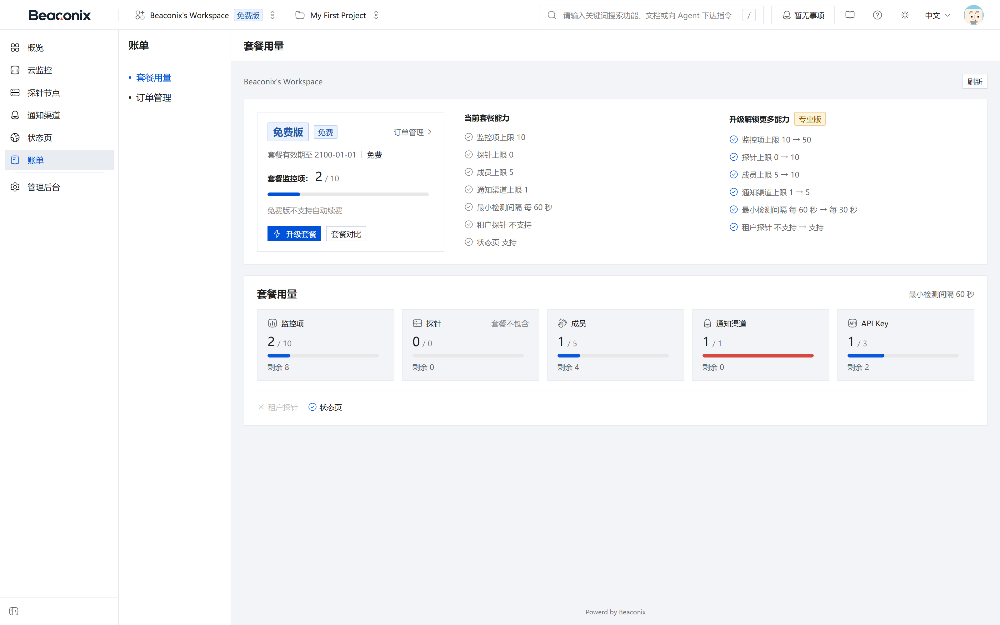
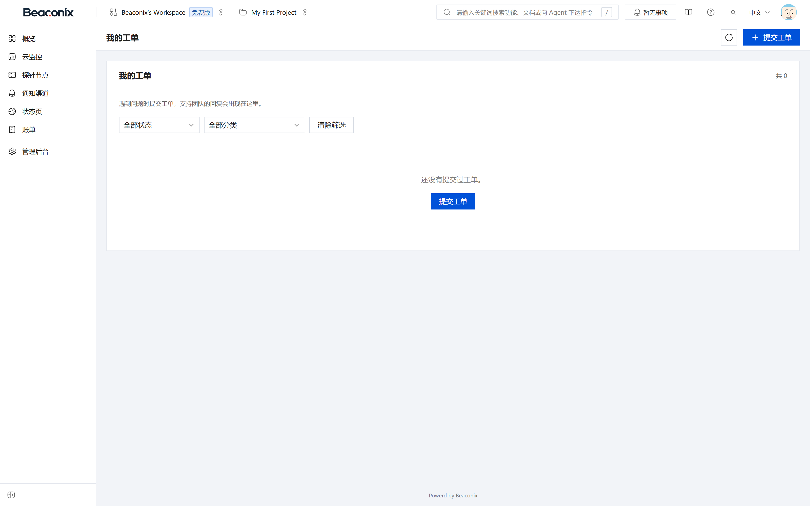
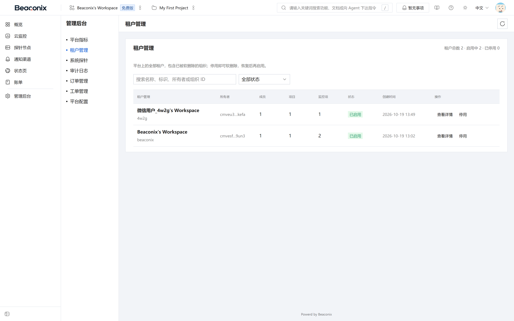

# 运营、计费与工单

本章说明系统的商业化支撑能力，包括套餐与配额、订阅与支付、到期处理、工单服务、管理后台与系统设置。

## 套餐与配额

### 套餐

套餐是计费与配额的模板，由平台方维护，所有组织共享同一套套餐目录。

每个套餐包含名称、描述、价格、计费周期（月付或年付，可同时提供多种周期）、等级序号与配额上限。配额上限覆盖可创建的监控数量、探针数量、成员数量、状态页数量与检查频率下限等维度。等级序号用于比较套餐高低，是订阅叠加判定的依据。

套餐操作：用户侧可查看在售套餐清单与套餐详情（包含价格、周期与配额明细）；平台管理侧可创建、修改、下架套餐，下架后的套餐不再出现在用户侧清单中，但已产生的订阅不受影响。

### 配额

组织配额由当前生效的订阅决定。配额查询接口返回各维度的上限、已用量与剩余量，并对已达上限的维度给出明确标记。

配额在资源创建时校验：创建监控、添加成员、创建探针、创建状态页等操作在超出上限时被拒绝，并返回当前上限与已用量，便于用户判断需要升级套餐。配额校验在服务端完成，不依赖客户端提示。

## 订单与支付

### 下单

组织管理员选择套餐与计费周期后下单。下单时系统记录套餐快照（名称、周期、价格、配额），确保后续套餐调整不影响已下单订单的金额与权益。订单初始状态为待支付，具备有效期，超时未支付自动关闭。

订单操作：查看订单列表与详情、取消待支付订单。已完成支付的订单不可取消，只能走退款流程。

### 支付

表 8-1 订单与支付状态

| 对象 | 状态 | 说明 |
| --- | --- | --- |
| 订单 | 待支付 | 已创建，等待支付 |
| 订单 | 已支付 | 支付成功，权益已生效 |
| 订单 | 已取消 | 用户主动取消或超时关闭 |
| 订单 | 已退款 | 管理员执行退款 |
| 支付 | 待支付 | 支付单已创建，等待支付平台回调 |
| 支付 | 成功 | 支付平台确认收款 |
| 支付 | 失败 | 支付平台返回失败 |
| 支付 | 已退款 | 已完成退款 |

支付流程如下：

1. 用户对订单发起支付，系统向支付平台创建支付单，返回支付所需参数或二维码。
2. 用户在支付平台完成支付，支付平台向系统回调支付结果。
3. 系统对回调做签名验签，验签基于回调报文的原始字节计算，验签失败的回调一律拒绝并记录。
4. 验签通过后，系统按支付单标识与金额核对，核对一致则将支付单置为成功、订单置为已支付，并在事务中激活或续期订阅。
5. 处理完成后返回平台要求的应答，避免平台重复回调。

回调处理具备幂等性：同一支付单的重复回调不会重复激活订阅，仅返回成功应答。支付成功后系统推送站内通知，并在审计日志中记录。

## 订阅到期与续期

### 订阅状态

表 8-2 订阅状态

| 状态 | 含义 |
| --- | --- |
| 生效 | 订阅正常生效，配额按该订阅的套餐计算 |
| 暂停 | 被更高等级的订阅压制，剩余天数冻结，待高等级订阅结束后自动恢复 |
| 已过期 | 订阅到期未续费，配额回落到免费额度 |
| 已取消 | 用户主动取消，到期后不再续期 |

订阅支持叠加：同一组织可同时存在多个未到期订阅。当存在多个订阅时，系统以等级最高的套餐作为当前生效权益，其余订阅进入暂停状态并冻结剩余天数；高等级订阅到期后，被暂停的订阅自动恢复，剩余天数继续消耗。该机制使用户在升级套餐后不会损失原有权益的剩余时间。

### 到期处理

定时任务按周期扫描临期与到期订阅：

- 到期前按配置的提前天数推送续费提醒。
- 到期日将订阅置为已过期，配额回落，超出免费额度的资源不删除但不可新建，已有资源继续可用。
- 过期后推送到期通知，并在组织概览中提示需要续费。

续费通过重新下单支付完成；续费成功后从原到期时间顺延，而不是从支付时间起算，避免提前续费造成损失。

## 工单系统

工单用于用户与平台方之间的服务请求与问题反馈。

### 用户侧

- **提交工单**。选择分类，填写标题与内容，可附加附件。提交后生成工单编号，状态为待处理，并向平台方推送通知。
- **查看工单列表与详情**。返回本组织提交的工单，包含编号、分类、标题、状态、创建时间与最近更新时间；详情包含完整对话与活动记录。
- **回复工单**。在工单下追加回复，回复后工单状态回到待处理，并通知对方。
- **关闭工单**。问题解决后由提交方关闭，关闭后不再接受新回复。
- **查看分类**。返回可选的工单分类，分类由平台方维护。

### 平台侧

- **工单列表与筛选**。按状态、分类、优先级、提交组织与时间区间筛选。
- **工单统计**。返回各状态工单数量、平均响应时长与处理时长。
- **处理工单**。修改状态（受理、处理中、待确认、已解决、已关闭）、调整优先级、指派处理人。
- **回复工单**。以平台方身份回复，回复后通知提交方。
- **删除工单**。删除后不再出现在双方列表中。
- **分类管理**。创建、修改、删除工单分类。

工单的全部操作均写入工单活动记录，包含操作者类型（用户或平台）、动作、时间与备注；状态变更与回复同时触发站内通知，保证双方及时感知。

## 管理后台

管理后台面向平台运营人员，要求平台级超级管理员身份，全部接口独立鉴权并记录审计。

表 8-3 管理后台功能

| 功能组 | 能力 |
| --- | --- |
| 租户管理 | 租户列表与详情、启用与停用；停用后该组织成员无法访问业务接口 |
| 订单管理 | 订单列表与详情、标记已支付、退款、取消；用于线下支付与异常处理 |
| 套餐管理 | 套餐创建、查询、修改、下架 |
| 审计日志 | 跨租户检索全量审计记录，支持按租户、实体、操作类型与时间筛选 |
| 运营指标 | 调度队列指标、平台概览（租户数、监控数、检查量）、租户维度指标 |
| 系统探针 | 系统探针的创建、校验、启用与停用、删除、负载再平衡 |
| 工单管理 | 工单列表、统计、处理、回复、删除 |
| 工单分类 | 分类的创建、修改、删除 |
| 系统设置 | 设置项查询与修改，含公开设置与内部开关 |

运营指标中的调度队列指标返回各队列的等待数量、处理中数量、失败数量与吞吐，用于判断检查任务是否积压；平台概览与租户指标用于了解使用规模与增长趋势。

## 系统设置

系统设置以键值形式集中管理平台级配置，供运营人员在不停机的情况下调整运行行为。

表 8-4 设置项说明

| 属性 | 说明 |
| --- | --- |
| 键 | 唯一标识，按分组命名，如注册开关、维护模式、邮件发送参数 |
| 值类型 | 字符串、数字、布尔或结构化数据，写入时按声明类型校验 |
| 是否公开 | 公开项可被未登录请求读取，用于客户端决定界面呈现；非公开项仅管理端可读 |
| 分组 | 按业务分组组织设置项，便于界面按组展示 |
| 生效方式 | 多数设置读取即刻生效，无需重启服务 |

管理端可查询全部设置项、按分组查询、按键查询与修改。修改设置记录审计，记录修改前后的值。公开设置接口不返回任何敏感字段，也不返回内部调试开关。

系统另提供维护模式开关：开启后，除认证、健康检查与只读查询外的写操作被拒绝，并返回维护提示，用于发布窗口内阻止数据变更。

## 计费、工单与管理后台界面

**账单页**（图 8-1）展示当前订阅的套餐、生效状态与到期时间，以及各配额维度的上限与已用量进度；下方为套餐选择与下单入口，可查看历史订单及其支付状态。

**工单页**（图 8-2）以列表呈现本组织提交的工单，包含编号、分类、标题、状态与最近更新时间，支持按状态筛选与新建工单；进入详情可查看对话与活动记录并追加回复。

**管理后台**（图 8-3）仅对平台超级管理员可见，独立于业务导航成组展示，包含租户管理、订单管理、套餐管理、审计日志、运营指标、系统探针、工单管理与工单分类、系统设置。管理后台的每个操作同样写入审计日志。

