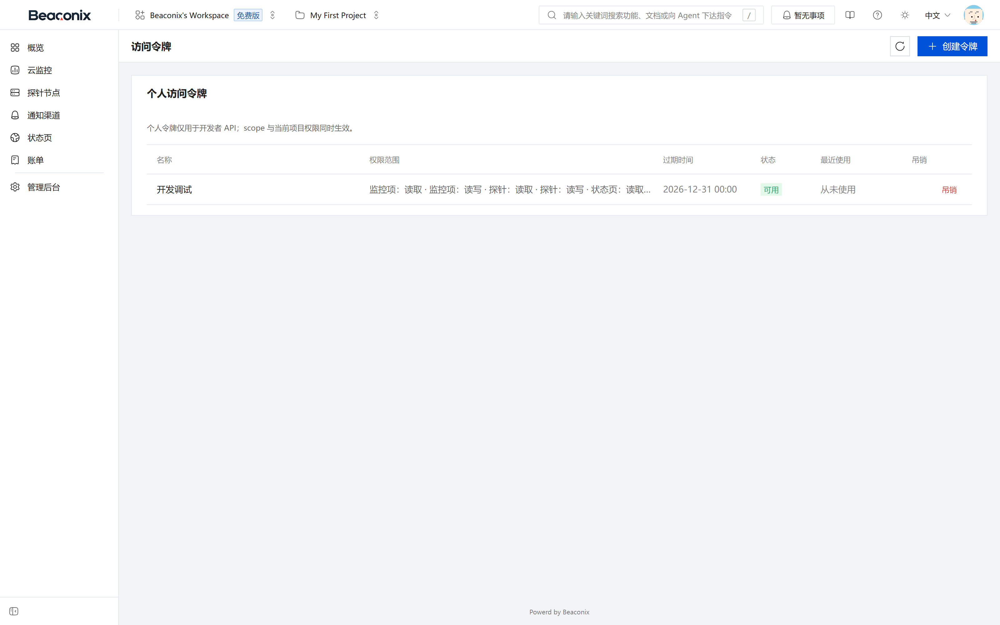

# 开放能力与集成

本章说明系统对外提供的凭据体系、开放接口以及与第三方系统的集成方式，供集成开发人员使用。

## 开发者凭据

系统提供两类对外凭据，分别面向组织集成与个人使用。

### 组织接口凭据

组织接口凭据用于以组织身份调用开放接口，由组织管理员创建。

- **创建凭据**。提交名称与备注后创建。系统生成以固定前缀开头的凭据字符串，**仅在创建时返回一次明文**，之后只展示掩码与末尾若干位。凭据可设置过期时间与权限范围。
- **查看凭据列表**。返回组织内全部凭据的名称、前缀、脱敏值、创建人、创建时间、最近使用时间与状态。
- **吊销凭据**。吊销后立即失效，使用该凭据的请求返回未认证错误；吊销不删除历史记录，便于审计追溯。

凭据在服务端仅保存散列值，无法从存储中还原明文，因此凭据丢失后只能重新创建。

### 个人访问令牌

个人访问令牌用于以个人身份调用开放接口，由用户本人在个人设置中创建。

- **创建令牌**。提交名称与可选有效期，生成令牌并仅返回一次明文。
- **查看令牌列表**。返回个人全部令牌的名称、脱敏值、创建时间、最近使用时间与状态。
- **吊销令牌**。吊销后立即失效。

个人令牌的权限不超出所属用户在当前组织中的角色权限；用户被移出组织后，其令牌对该组织资源的访问同样失效。

### 凭据安全

- 凭据创建与吊销均记录审计，并推送站内通知，便于所有者及时发现异常创建。
- 凭据相关接口受频率限制，防止暴力猜测。
- 凭据仅通过请求头传递，不接受通过查询参数传递，避免凭据出现在访问日志与浏览器历史中。

## 开发者开放接口

开放接口以 `/developer/v1` 为前缀，提供面向外部集成的精简能力集，鉴权使用组织接口凭据或个人访问令牌。

表 9-1 开放接口能力

| 能力 | 主要操作 | 说明 |
| --- | --- | --- |
| 组织概览 | 查询组织资源概览 | 返回监控、探针、状态页的数量与状态分布 |
| 监控管理 | 查询、创建、修改、暂停、恢复、删除与恢复监控 | 与内部接口共享同一套业务规则与校验 |
| 探针管理 | 查询、创建、修改、删除探针，轮换密钥，绑定与解绑监控 | 用于集成方自助管理采集节点 |
| 探针数据 | 查询探针的结果与执行记录 | 用于集成方同步采集数据 |
| 状态页管理 | 查询、创建、修改、删除状态页 | 用于集成方自动化维护公开页面 |

开放接口的权限判定沿用组织成员关系与项目授权：以组织凭据调用时，按凭据创建人的有效权限判定；以个人令牌调用时，按该用户的权限判定。越权访问返回无权限错误，且不泄露资源是否存在。

开放接口的响应结构与内部接口保持一致，错误码语义相同，便于集成方复用处理逻辑。开放接口的调用计入频率限制，限制阈值按凭据维度统计。

## 第三方集成

### 邮件

系统通过邮件服务商发送事务性邮件，包含邮箱验证、邀请、口令重置与任务提醒等场景。邮件正文由模板渲染，模板支持变量替换（收件人、组织名称、有效时间、任务标题等），模板变更不影响已发送邮件。发送失败按策略重试，超过重试次数后记录失败原因。

### 即时通讯

系统对接飞书、企业微信与钉钉的群机器人接口，将告警与恢复消息推送至指定群。消息以卡片或结构化文本形式呈现，包含监控名称、目标地址、当前状态、触发规则、首次发生时间与恢复时间。各平台支持加签校验的，系统按各平台算法生成签名。

### 微信生态

- **登录**。支持网页授权登录、小程序登录与扫码登录，详见 4.5 节。
- **订阅消息**。告警可通过微信订阅消息推送至指定用户，需预先配置应用标识、模板标识与接收人标识，并遵守微信平台的订阅规则。
- **支付**。订单支付通过微信支付完成，回调验签与幂等处理详见 8.2 节。

### 对象存储

附件存储支持本地磁盘与兼容 S3 协议的对象存储两种方式，通过配置切换。对象存储方式下，系统负责生成对象键、上传文件并返回访问地址；本地磁盘方式下，文件写入配置目录并由静态资源服务对外提供。两种方式对上层业务透明，附件记录的存储方式字段用于区分。

## 接口文档与联调

系统在运行时依据接口元数据生成 OpenAPI 描述文档，并在 `/api/docs` 提供交互式调试界面。

- 文档按业务模块分组，每个接口包含方法、路径、参数说明、请求体结构、响应结构与权限要求。
- 文档支持两种认证方式在线调试：访问令牌与组织凭据，调试请求按真实鉴权链路执行，权限不足会如实返回错误。
- 文档界面支持中文，随服务启动自动生成，不需要单独维护文档文件。
- 除交互式界面外，系统还提供结构化接口描述，可直接导入第三方接口工具生成客户端代码。

联调建议流程：创建组织凭据 → 在文档中以凭据调试只读接口 → 确认数据范围无误后调试写接口 → 将凭据与接口集成到自有系统。为避免影响生产数据，建议在测试组织内完成联调后再切换至正式组织。

## 凭据管理界面

**访问令牌页**（图 9-1）集中管理两类凭据：组织接口凭据以表格列出名称、凭据前缀、脱敏值、创建人、创建时间、最近使用时间与状态，提供新建与吊销操作；个人访问令牌以同样的结构展示，作用范围限定为当前用户。新建凭据时仅弹出一次明文，页面明确提示"关闭后不可再次查看"，避免用户误以为可随时复制。

