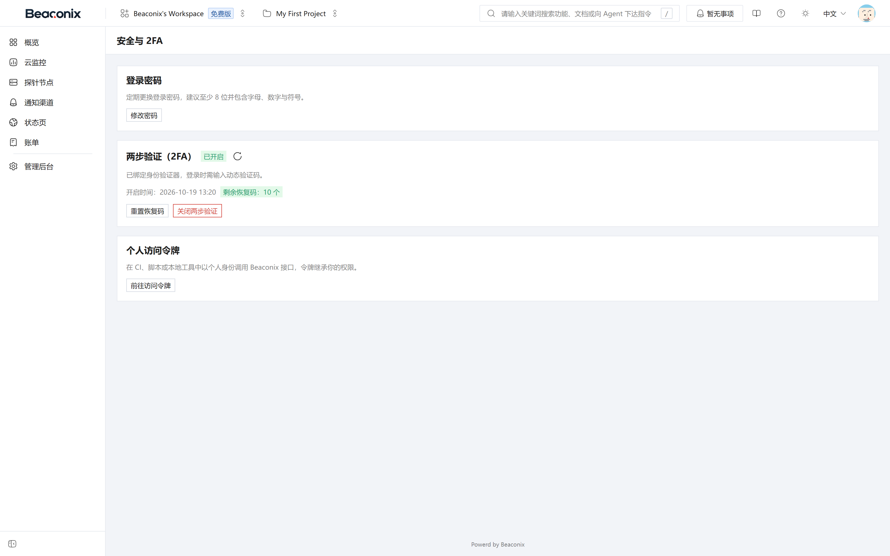

# 安全设计

本章说明系统在认证、授权、数据隔离、传输存储、审计与流量防护方面的设计，对应系统实际实现的防护措施。

## 认证与凭据安全

### 口令保护

用户口令使用自适应散列算法加盐存储，不可逆推。散列计算在服务端完成，接口接收的明文口令在内存中用完即弃，不落盘、不写日志。口令长度与复杂度在注册与修改时校验，连续失败次数受频率限制约束。

### 令牌安全

- 访问令牌采用自包含结构，携带用户标识、角色与签发时间，服务端校验签名与有效期，不依赖服务端会话。
- 刷新令牌采用轮换策略，一经使用即失效，旧令牌再次使用会被识别为异常并拒绝。
- 令牌有效期可配置，访问令牌短、刷新令牌长，兼顾安全与体验。
- 用户修改口令、账号被停用、凭据被吊销时，相关令牌立即失效，无需等待自然过期。

### 验证码与双因素

一次性验证码具有有效期与最大尝试次数，超限即作废；重复索取受频率限制。双因素认证的动态口令基于时间窗口校验，允许有限的时钟漂移；恢复码以散列存储、单次使用，使用后立即作废并提示剩余数量。

### 凭据保护

组织接口凭据与个人访问令牌在数据库中仅保存散列值，创建时一次性返回明文。凭据查询接口只返回掩码与末尾若干位，任何接口都不会二次返回明文。

## 授权与越权防护

### 默认拒绝

系统采用默认拒绝策略：所有接口默认要求有效认证，只有显式标记为公开的接口才允许匿名访问。新增接口若未声明认证要求，将自动纳入保护范围，不会因遗漏声明而暴露。

### 双层判定

授权判定分为两步：先判定身份是否有效，再判定该身份对目标资源是否具备所需权限。两步分离使得"未登录"与"已登录但无权限"返回不同错误，既不误判也不泄露资源存在性。

组织级资源判定成员资格与角色等级，项目级资源判定项目成员与资源授权，两套判定的适用范围在 5.3 节已明确，接口实现中不会混用。

### 越权防护要点

- **租户边界由请求推导而非客户端声明**。组织标识从路径参数或父级资源解析，解析结果与资源实际归属比对，二者不一致即拒绝。
- **父资源校验**。访问子资源（如某监控的检查记录）时，先校验父资源归属，避免通过构造子资源标识越权访问其他组织的数据。
- **写操作校验归属**。更新与删除操作在执行前加载目标记录并校验归属，不做"按标识直接更新"的操作。
- **列表查询强制带边界**。列表接口的查询条件中强制注入组织或项目条件，客户端传入的筛选条件不能覆盖该边界。
- **超级管理员通道独立**。平台管理接口由独立守卫与独立的路径前缀保护，不与业务接口共用权限判定路径。

## 多租户数据隔离

系统在三个层面保证租户隔离：

1. **数据层**。全部业务表均带组织外键，从属资源通过父资源间接归属组织；需要对外唯一的字段（项目标识键、状态页标识）在组织维度内建立唯一约束，避免跨租户的取值冲突与信息泄露。
2. **服务层**。服务方法接收组织上下文，查询与写入均以该上下文为条件；跨组织的关联（如把任务指派给其他组织成员）在校验阶段被拒绝。
3. **接口层**。响应数据经过序列化过滤，不返回内部自增主键以外的敏感关联信息；错误信息不包含其他租户的资源标识。

附件的隔离通过可见性字段与访问签名实现：公开附件可通过链接访问，受限附件需要有效凭证且校验归属。附件存储路径按组织分目录，避免目录遍历导致的越权读取。

## 传输与存储安全

### 传输

- 生产环境要求全站 HTTPS，接口服务部署在反向代理之后时由代理终结证书。
- 为响应附加安全头：内容安全策略、禁止页面被嵌入、禁止 MIME 类型嗅探、限制引用来源等。
- 跨域请求按来源白名单处理，未配置白名单时不放行跨域，避免任意站点携带凭证发起请求。
- 支付回调验签基于原始报文，防止报文被篡改或伪造。

### 存储

- 口令、令牌、凭据、渠道密钥等敏感字段均以散列或密文形式存储。
- 对象存储与本地磁盘两种附件存储方式均对上传文件做类型与大小校验，拒绝可执行文件与超限文件。
- 上传目录与代码目录分离，静态资源服务只暴露指定目录，不可通过路径穿越访问其他目录。
- 数据库连接使用最小权限账号，迁移与运行账号分离。

## 审计与合规

### 审计内容

审计日志记录每次写操作的操作者、操作类型、目标实体、变更前后快照、来源地址、请求方法与路径、发生时间。认证类操作（登录、找回口令、双因素变更）同样记录，但不记录凭据明文。

### 审计特性

- **不可篡改**。审计日志只追加，不提供修改与删除接口；普通成员不可访问。
- **脱敏**。口令、令牌、密钥类字段在写入前替换为掩码，审计日志本身不构成新的泄露面。
- **非阻塞**。审计写入异步执行，失败不影响业务响应，失败情况记录到服务日志供运维发现。
- **可检索**。支持按组织、实体类型、操作类型、操作者与时间区间组合查询，单条记录支持查看变更前后差异。

### 合规要点

审计日志可用于回答"谁在何时修改了哪条数据、改成了什么"，满足内部审计与外部合规检查的基本要求。数据保留周期可配置，超期数据按策略归档或清除。

## 限流与防护

### 访问频率限制

系统对全部接口实施访问频率限制，按接口与来源统计。不同接口类型使用不同阈值：

表 10-1 限流策略

| 接口类别 | 限制强度 | 说明 |
| --- | --- | --- |
| 验证码与注册 | 严格 | 防止邮件轰炸与批量注册 |
| 登录与找回口令 | 严格 | 防止口令暴力猜测 |
| 普通读写接口 | 常规 | 按用户或来源统计 |
| 开放接口 | 按凭据 | 防止单个集成方占用过多资源 |
| 公开接口（状态页、公开设置） | 宽松但可观测 | 允许匿名访问但保留统计 |

触发限制时返回明确的限流错误与建议重试时间，不返回模糊的服务错误，便于调用方处理。

### 其他防护

- **维护模式**。发布窗口内可开启维护模式，拒绝写操作并返回维护提示，避免发布期间产生脏数据。
- **异常统一处理**。未预期异常统一转换为标准错误响应，不返回堆栈、SQL 语句与内部路径。
- **参数白名单校验**。请求参数按声明的数据结构校验，未声明字段被剔除，防止通过附加字段篡改不应修改的属性（如角色、组织标识）。
- **输出字段过滤**。响应序列化阶段剔除敏感字段，即使服务层误将敏感字段放入返回对象，也不会出现在响应中。
- **健康检查分离**。健康检查接口独立于业务接口，就绪检查包含数据库与缓存的连通性，供编排系统判定实例可用性。

## 安全设置界面

**安全设置页**（图 10-1）提供口令修改、双因素认证开关与恢复码管理：双因素认证区展示当前启用状态、绑定入口与剩余恢复码数量，关闭与重新生成恢复码均需二次验证；页面同时提供最近的安全事件记录，便于账号所有者核对是否有非本人操作。

账户安全相关操作在界面与接口两侧施加同样的校验，界面隐藏按钮只是减少误操作，真正的拦截始终发生在服务端。

