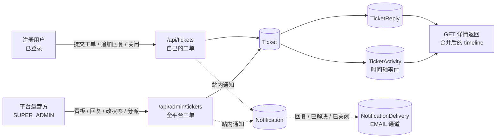

# 005：平台工单系统（Support Ticket）设计方案

- 状态：草案 v5（**简化版 + 独立时间轴 + 站内/邮件通知**，Design Proposal）
- 定位：**Beacon 平台自身的支持工单** —— 已登录的注册用户（租户成员）向平台运营方提交问题/需求，平台侧 `SUPER_ADMIN` 统一看板处理并回复。工单是**平台级资源**，不属于任何 Project，也不是租户内部的客服系统。
- 决策记录：
    - `dec-32460883e5494aa7`（v4 简化）：双方 = 注册用户 → 平台运营方；提交必须登录；仅保留状态 / 优先级 / 分类。
    - `dec-8650b02b80fd5ae7`（v5 恢复）：**保留独立时间轴表 `TicketActivity`**（详情接口合并回复与事件返回）；**保留站内 + 邮件通知**（站内覆盖 4 类事件，邮件仅回复与状态变更）。
- 适用代码库：Beacon（NestJS 11 + Prisma 7 + PostgreSQL，多租户）
- 规模目标：**4 个模型、4 个枚举、15 个端点**（用户端 6 + 平台端 9），另加 `NotificationType` 4 个新值与 2 个邮件模板；一个模块 + 一个 admin 子目录，**不新增端点、不新建后台队列（复用现有 `NotificationDelivery` 出站队列）、不做外部邮件入站、不新增定时任务**。

---

## 1. 业务闭环



1. 用户在 Beacon 内提交工单：`subject` + `content` + 可选的 `categoryId` / `priority`。
2. 平台运营方在 admin 看板看到全部工单，可改优先级 / 分类 / 处理人 / 状态，并回复（公开回复或内部备注）。
3. 用户在自己的工单详情里看到公开回复与完整时间轴，可继续回复（已解决/已关闭的工单被回复时自动重新打开），也可自行"确认解决/关闭"。
4. 状态、优先级、分类三项是唯一的管理维度；**时间轴 = 事件（`TicketActivity`）+ 公开回复（`TicketReply`）按时间归并**，在同一次详情请求中返回。
5. 关键节点通过 `NotificationsService` 落站内通知；其中"新的回复"与"工单已解决/已关闭"额外通过 `EmailService` 发邮件。

**验收口径**：一个用户能提交、能看见回复与时间轴、能关闭；一个 `SUPER_ADMIN` 能在一屏里看完所有工单并回复；被回复/被关闭的对方能在站内收件箱看到未读通知，邮件异步送达。

---

## 2. 相比 v3（全功能客服系统）删掉了什么

| 删除项 | 原因 |
| --- | --- |
| `TicketContact`（客户联系人）、代客建单 | 提交人就是登录用户，`authorId` 直连 `User` |
| 公开 Portal / magic link / `tk_` 访问令牌 / 匿名提交 | v4 硬约束（v5 沿用）：提交必须登录，工单域**零 `@Public()`** |
| 邮件入站（IMAP / provider webhook）、`TicketMailbox`、`Message-Id` 线程匹配 | 回复全部在站内进行；邮件通道只做**出站**通知 |
| Developer API 端点与 `tickets:read/write` scope | 外部系统无建单场景 |
| SLA（首次响应/解决时限、营业时间、违约升级）、`TicketSla`、`TicketSlaBreach` | 只保留 `firstRespondedAt / resolvedAt / closedAt` 三个统计时间点，不做承诺与告警 |
| 满意度 CSAT、知识库 KB、宏、草稿、工时、自定义字段、自动分派、自动化规则引擎、工单合并/关联、客服团队、Webhook、CSV 报表、批量操作、在线冲突检测 | 全部移出 v5 范围 |
| `TicketWatcher`（关注者）、`TicketAttachment`（附件） | 时间轴与通知已覆盖"知情"诉求；关注/附件列为后续增量 |
| 组织级 `TicketSettings`（回复邮件总开关、自动关闭天数、默认优先级…） | 工单是平台级资源，邮件开关由**平台 settings**（SMTP 通道）统一决定，不做组织级设置表 |
| `PENDING`（等待客户回复）状态 | 4 状态足够：`OPEN → PROCESSING → RESOLVED → CLOSED` |
| `OrgMemberGuard + RolesGuard` 轨道 | 工单是平台级、跨租户资源，租户成员等级无法表达"平台运营方"，改用 `SuperAdminGuard`（与 `admin/*` 现有写法一致） |

### 2.1 v5 相对 v4 恢复的两项

| 恢复项 | v5 落地方式 |
| --- | --- |
| 独立时间轴 | 新增 `TicketActivity` 表（仿 `TaskActivity`），记录建单、状态/优先级/分类变更、分派与取消分派；回复仍存 `TicketReply`；详情接口把两者归并为 `timeline` 返回 |
| 站内 + 邮件通知 | 站内走 `NotificationsService.publish`（`accessScope: 'ACCOUNT'`，4 类事件）；邮件走 `NotificationsService.enqueueEmail` + 2 个新模板，**只对"公开回复"与"已解决/已关闭"发信**，经 `NotificationDelivery` 异步投递 |

仍然不做：关注者、附件、通知偏好/免打扰/摘要、@提及、Webhook/WebPush 等其它通知渠道。

---

## 3. 数据模型

迁移后执行 `pnpm prisma:generate`（生成的 client 不进 Git）。

### 3.1 枚举

```prisma
enum TicketStatus {
  OPEN        // 待处理（用户提交后的初始状态）
  PROCESSING  // 平台处理中（首次公开回复或手动受理）
  RESOLVED    // 已解决（等待用户确认或平台关闭）
  CLOSED      // 已关闭（终态，用户回复可重开）
}

enum TicketPriority {
  LOW
  MEDIUM
  HIGH
  CRITICAL
}

enum TicketAuthorType {
  USER   // 提交工单的注册用户
  STAFF  // 平台运营方（SUPER_ADMIN）
}

// 时间轴事件类型（回复不进本枚举，由 TicketReply 承载）
enum TicketActivityType {
  CREATED          // 提交工单
  STATUS_CHANGED   // 显式状态迁移（admin PATCH / 用户 close / 用户回复触发的重开）
  PRIORITY_CHANGED
  CATEGORY_CHANGED
  ASSIGNED         // 分派 / 改派给处理人
  UNASSIGNED       // 取消分派
}

// 扩展现有枚举：只追加 4 个值，不改既有 notification 行为
enum NotificationType {
  // ...既有值保持不变
  TICKET_CREATED
  TICKET_REPLIED
  TICKET_STATUS_CHANGED
  TICKET_ASSIGNED
}
```

### 3.2 模型（4 个）

```prisma
// 平台工单
model Ticket {
  id             String         @id @default(cuid())
  number         Int            @unique // 全平台自增，展示为 #1024
  subject        String
  content        String
  status         TicketStatus   @default(OPEN)
  priority       TicketPriority @default(MEDIUM)
  categoryId     String?

  authorId       String // 提交人（登录用户），必填
  organizationId String? // 提交人当时所属组织快照，仅用于平台侧识别租户，不参与权限
  assigneeId     String? // 平台处理人（SUPER_ADMIN），可空

  firstRespondedAt DateTime? // 平台首次公开回复时间（仅统计）
  resolvedAt       DateTime?
  closedAt         DateTime?

  createdAt DateTime  @default(now())
  updatedAt DateTime  @updatedAt
  deletedAt DateTime? // 平台清理垃圾工单用软删

  author       User            @relation("TicketAuthor", fields: [authorId], references: [id], onDelete: Restrict)
  assignee     User?           @relation("TicketAssignee", fields: [assigneeId], references: [id], onDelete: SetNull)
  organization Organization?   @relation(fields: [organizationId], references: [id], onDelete: SetNull)
  category     TicketCategory? @relation(fields: [categoryId], references: [id], onDelete: SetNull)
  replies      TicketReply[]
  activities   TicketActivity[]

  @@index([authorId, createdAt])
  @@index([status, createdAt])
  @@index([priority])
  @@index([categoryId])
  @@index([assigneeId])
  @@index([deletedAt])
  @@map("tickets")
}

// 回复（用户帖 / 平台帖 / 平台内部备注共用一张表）
model TicketReply {
  id             String           @id @default(cuid())
  ticketId       String
  authorId       String
  authorType     TicketAuthorType
  body           String
  isInternalNote Boolean          @default(false) // true = 仅平台侧可见，不出现在用户端任何响应与通知中
  createdAt      DateTime         @default(now())
  updatedAt      DateTime         @updatedAt

  ticket Ticket @relation(fields: [ticketId], references: [id], onDelete: Cascade)
  author User   @relation("TicketReplyAuthor", fields: [authorId], references: [id], onDelete: Restrict)

  @@index([ticketId, createdAt])
  @@index([authorId])
  @@map("ticket_replies")
}

// 时间轴事件（只记"动作"，不记回复正文）
model TicketActivity {
  id        String             @id @default(cuid())
  ticketId  String
  actorId   String? // 操作人；用户被删除后置 null，时间轴仍需保留
  actorType TicketAuthorType // 快照：actor 为空时仍能标注"用户 / 平台"
  type      TicketActivityType
  field     String? // status | priority | categoryId | assigneeId
  oldValue  String?
  newValue  String?
  meta      Json               @default("{}") // 例如 { assigneeName } / { categoryName }
  createdAt DateTime           @default(now())

  ticket Ticket @relation(fields: [ticketId], references: [id], onDelete: Cascade)
  actor  User?  @relation("TicketActivityActor", fields: [actorId], references: [id], onDelete: SetNull)

  @@index([ticketId, createdAt])
  @@index([actorId])
  @@map("ticket_activities")
}

// 分类（平台级字典，全局共享，不按组织隔离）
model TicketCategory {
  id          String   @id @default(cuid())
  name        String   @unique
  description String?
  sortOrder   Int      @default(0)
  isActive    Boolean  @default(true) // 停用后不再出现在提交选项，历史工单保留
  createdAt   DateTime @default(now())
  updatedAt   DateTime @updatedAt

  tickets Ticket[]

  @@index([isActive, sortOrder])
  @@map("ticket_categories")
}
```

### 3.3 反向关系字段

- `User`：`tickets Ticket[] @relation("TicketAuthor")`、`assignedTickets Ticket[] @relation("TicketAssignee")`、`ticketReplies TicketReply[] @relation("TicketReplyAuthor")`、`ticketActivities TicketActivity[] @relation("TicketActivityActor")`
- `Organization`：`tickets Ticket[]`

> `Notification` / `NotificationDelivery` 模型结构不改动，只扩展 `NotificationType` 枚举值（通知复用现有的站内收件箱、SSE 推送与 `NotificationDelivery` 出站队列）。

### 3.4 编号生成

沿用 `TasksService.create` 的模式，在事务内取全局最大 `number` 再 `+1`，依赖 `@@unique([number])` 兜底，冲突（`P2002`）时重试一次：

```ts
const last = await tx.ticket.findFirst({
    orderBy: { number: 'desc' },
    select: { number: true },
});
const number = (last?.number ?? 0) + 1;
```

### 3.5 软删除边界

- `Ticket.deletedAt`：仅平台侧 `DELETE /api/admin/tickets/:ticketId` 写入；所有用户端与 admin 查询必须带 `deletedAt: null`。
- `TicketReply` / `TicketActivity`：不做软删（回复不可编辑删除；时间轴不可篡改），随工单硬删级联（`onDelete: Cascade`）；工单本身走软删，因此时间轴在软删期间仍完整保留。
- `TicketCategory`：不做软删，用 `isActive=false` 停用，被工单引用时禁止删除。

---

## 4. 权限模型

| 轨道 | 端点 | 守卫 | 数据范围 |
| --- | --- | --- | --- |
| 用户端 | `/api/tickets*` | 全局 `JwtAuthGuard` | 服务层强制 `authorId = jwt.sub`，越权访问返回 `404`（不泄露存在性） |
| 平台端 | `/api/admin/tickets*`、`/api/admin/ticket-categories*` | `SuperAdminGuard` | 全平台，无组织过滤 |
| 通知 | `/api/notifications*`（既有） | 全局 `JwtAuthGuard` | 复用现有收件箱，不新增端点 |

要点：

1. **不使用** `OrgMemberGuard` / `RolesGuard` / `ProjectAccessGuard`：工单既不属于 Project，也不该被租户成员等级限制（否则平台运营方得先加入租户才能处理工单）。`SuperAdminGuard`（`src/common/guards/super-admin.guard.ts`）已是 `admin/*` 的既有做法，直接复用。
2. 用户端控制器**不得**导入 `@Public()`、`OrgMemberGuard`、`RolesGuard`。
3. 用户端只返回 `isInternalNote = false` 的回复；admin 端返回全部并标注。
4. 用户端与 admin 端都返回完整 `timeline`（`TicketActivity` 全部可见）：内部备注**不写** `TicketActivity`，因此用户端时间轴不会出现"平台添加了内部备注"这类泄漏。
5. `organizationId` 只是创建时由服务端派生的快照（取用户最早加入且未删除的组织），用户不可指定，不参与任何查询过滤。
6. 通知的可达性由 `NotificationsService` 统一校验：工单通知使用 `accessScope: 'ACCOUNT'`（`NotificationAccessService.eligible` 对 ACCOUNT 只要求目标用户存在且有效），因此**跨组织**的提交人与平台运营方都能收到；不要把工单通知塞进 `ORGANIZATION` / `PROJECT` scope。

---

## 5. 状态机（`ticket-state.ts`，纯函数，可单测）

```
OPEN        → PROCESSING | RESOLVED | CLOSED
PROCESSING  → OPEN（退回重排）| RESOLVED | CLOSED
RESOLVED    → OPEN（重开）| CLOSED
CLOSED      → OPEN（重开）
```

| 触发方 | 动作 | 状态效果 | 时间轴 | 通知 |
| --- | --- | --- | --- | --- |
| 用户 | 提交工单 | 创建 `OPEN` | `CREATED` | 站内 → 平台运营方 |
| 用户 | 追加公开回复 | `RESOLVED` / `CLOSED` → `OPEN`（清 `resolvedAt` / `closedAt`）；其余状态不变 | 仅重开时写 `STATUS_CHANGED` | 站内 + 邮件 → 处理人（未分派则运营方） |
| 用户 | `close` | `OPEN` / `PROCESSING` / `RESOLVED` → `CLOSED`（写 `closedAt`）；已 `CLOSED` → `409 TICKET_ALREADY_CLOSED` | `STATUS_CHANGED` | 站内 → 处理人（未分派时运营方）；不发邮件 |
| 平台 | 首次**公开**回复 | `OPEN` → `PROCESSING`，写 `firstRespondedAt`（仅一次）；内部备注不触发 | 不写（回复本身即证据） | 站内 + 邮件 → 提交人 |
| 平台 | 改状态 | 按上表校验，非法迁移 → `409 INVALID_TICKET_TRANSITION` | `STATUS_CHANGED` | 站内 → 提交人/处理人；`RESOLVED`/`CLOSED` 另发邮件给提交人 |
| 平台 | `RESOLVED` | 写 `resolvedAt` | `STATUS_CHANGED` | 同上 |
| 平台 | `CLOSED` | 写 `closedAt` | `STATUS_CHANGED` | 同上 |
| 平台 | 重开（→ `OPEN`） | 清 `resolvedAt` / `closedAt` | `STATUS_CHANGED` | 站内 → 提交人/处理人（不发邮件） |
| 平台 | 改优先级 / 分类 / 处理人 | — | `PRIORITY_CHANGED` / `CATEGORY_CHANGED` / `ASSIGNED` / `UNASSIGNED` | 分派：站内 → 新处理人；其余不发 |

```ts
// src/modules/tickets/ticket-state.ts
const ALLOWED: Record<TicketStatus, TicketStatus[]> = {
    OPEN: ['PROCESSING', 'RESOLVED', 'CLOSED'],
    PROCESSING: ['OPEN', 'RESOLVED', 'CLOSED'],
    RESOLVED: ['OPEN', 'CLOSED'],
    CLOSED: ['OPEN'],
};

export function assertTransition(from: TicketStatus, to: TicketStatus): void {
    if (from === to) return; // 幂等
    if (!ALLOWED[from].includes(to)) {
        throw new ConflictException({
            code: 'INVALID_TICKET_TRANSITION',
            message: `Cannot move ticket from ${from} to ${to}`,
        });
    }
}
```

状态只能通过 `close` 端点或 admin `PATCH` 修改，用户端提交/回复不接受 `status` 字段。同状态重复 `PATCH` 幂等且**不写时间轴、不发通知**。

---

## 6. API 设计

全局前缀 `/api`；列表统一返回 `{ data, meta: { total, page, limit, totalPages } }`（`TransformInterceptor` 再包一层）。所有端点均需登录。

### 6.1 用户端 `src/modules/tickets/tickets.controller.ts`

| 方法 | 路径 | 说明 |
| --- | --- | --- |
| POST | `/api/tickets` | 提交工单：`subject`(4–200)、`content`(1–5000)、`priority?`、`categoryId?` |
| GET | `/api/tickets` | 我的工单：`status?`、`categoryId?`、`page`、`limit` |
| GET | `/api/tickets/:ticketId` | 详情：工单 + `timeline`（公开回复与事件归并，升序）；非本人 → 404 |
| POST | `/api/tickets/:ticketId/replies` | 追加回复 `{ body }`；按 §5 自动重开 |
| POST | `/api/tickets/:ticketId/close` | 确认解决/关闭 |
| GET | `/api/tickets/categories` | 可选分类（仅 `isActive=true`），注册在 `:ticketId` 之前 |

**时间轴响应形状**（用户端与 admin 端一致，仅可见范围不同）：

```ts
type TicketTimelineItem =
    | {
          kind: 'reply';
          id: string;
          authorType: 'USER' | 'STAFF';
          author: { id: string; name: string; avatarUrl: string | null } | null;
          body: string;
          isInternalNote: boolean; // 用户端恒为 false
          createdAt: string;
      }
    | {
          kind: 'activity';
          id: string;
          actorType: 'USER' | 'STAFF';
          actor: { id: string; name: string; avatarUrl: string | null } | null;
          type: TicketActivityType;
          field: string | null;
          oldValue: string | null;
          newValue: string | null;
          meta: Record<string, unknown>;
          createdAt: string;
      };
```

详情响应：`{ ...ticket, timeline: TicketTimelineItem[], timelineTruncated: boolean }`。归并规则：两表各自 `orderBy: { createdAt: 'asc' }`、`take: 500`，在内存按 `createdAt` 升序合并；同一时间戳 `kind: 'reply'` 排在 `'activity'` 之前，再以 `id` 兜底，保证顺序稳定。超过 500 条时 `timelineTruncated: true`（单工单对话规模远小于此，不做分页端点）。

### 6.2 平台端 `src/modules/admin/tickets/`

`@Controller('admin/tickets')`、`@Controller('admin/ticket-categories')`，类级 `@UseGuards(SuperAdminGuard)`：

| 方法 | 路径 | 说明 |
| --- | --- | --- |
| GET | `/api/admin/tickets` | 全平台工单：`status`、`priority`、`categoryId`、`assigneeId`、`unassigned`、`q`（subject/content/author email 模糊）、`page`、`limit` |
| GET | `/api/admin/tickets/stats` | `{ total, byStatus, byPriority, unassigned }`，**注册在 `:ticketId` 之前** |
| GET | `/api/admin/tickets/:ticketId` | 详情：`timeline`（含内部备注，`isInternalNote: true`）、提交人、处理人 |
| PATCH | `/api/admin/tickets/:ticketId` | 更新 `priority?`、`categoryId?`、`assigneeId?`、`status?`（走状态机，写时间轴 + 通知） |
| POST | `/api/admin/tickets/:ticketId/replies` | 回复 `{ body, isInternalNote? }` |
| DELETE | `/api/admin/tickets/:ticketId` | 软删（垃圾/测试工单），不写时间轴、不发通知 |
| POST | `/api/admin/ticket-categories` | 新建分类 |
| PATCH | `/api/admin/ticket-categories/:categoryId` | 更新名称/描述/排序/启用状态 |
| DELETE | `/api/admin/ticket-categories/:categoryId` | 无工单引用则硬删；被引用 → `409 CATEGORY_IN_USE`（改用 `isActive=false` 停用） |

`assigneeId` 必须是 `globalRole = SUPER_ADMIN` 且 `isActive = true`、`deletedAt = null` 的用户。

### 6.3 DTO 校验

- `CreateTicketDto`：`subject` `@MinLength(4) @MaxLength(200)`；`content` `@MinLength(1) @MaxLength(5000)`；`priority` `@IsEnum`；`categoryId` `@IsCuid()`（service 再校验存在且 `isActive`）。
- `CreateTicketReplyDto`：`body` `@MinLength(1) @MaxLength(5000)`。
- `UpdateTicketDto`（admin）：全部可选、至少一项；`status` `@IsEnum(TicketStatus)`；`assigneeId` 显式传 `null` 表示取消分派（需 `@ValidateIf`/`@IsOptional` 组合，不要让 `null` 被当作缺失）。
- 用户端 DTO 中**不存在** `status`、`authorId`、`assigneeId`、`number`、`organizationId` 字段（`forbidNonWhitelisted` 会把它们打 400）。
- 时间轴与通知都不接受客户端输入：`TicketActivity` 全部由服务端写入，通知类型与收件人由服务端解析。

---

## 7. 实现要点

1. **作者隔离**：用户端每条查询都拼 `{ authorId: userId, deletedAt: null }`，`findOne` 用 `findFirst` 而非 `findUnique` 以保证条件生效；查不到统一抛 `NotFoundException`。
2. **内部备注不泄漏**：用户端详情取回复时加 `where: { isInternalNote: false }`；用户端 `TicketEntity` 只暴露工单字段与 timeline 中的公开项；内部备注既不写 `TicketActivity`、也不发通知、也不出现在用户端 timeline。
3. **公开回复自动受理**：admin 回复（`isInternalNote !== true`）时，若工单为 `OPEN`，同一事务内改 `PROCESSING` 并写 `firstRespondedAt`（只写一次）；这条自动迁移**不写** `TicketActivity`，避免与回复项重复。
4. **时间轴写入**（`src/modules/tickets/ticket-activity.ts`：纯函数负责构造事件数据，`recordActivity(db, data)` 是唯一写入口，均不依赖 Nest 容器，可单测）：
    - 建单：`CREATED`（`actorType: USER`，`field: null`）。
    - 用户 `close`：`STATUS_CHANGED`，`oldValue: 当前状态`，`newValue: 'CLOSED'`。
    - 用户回复触发自动重开：`STATUS_CHANGED`，`oldValue: 'RESOLVED' | 'CLOSED'`，`newValue: 'OPEN'`。
    - admin `PATCH`：状态 → `STATUS_CHANGED`；优先级 → `PRIORITY_CHANGED`；分类 → `CATEGORY_CHANGED`（`meta.categoryName` 快照，避免分类改名/删除后时间轴失真）；处理人 → `ASSIGNED` / `UNASSIGNED`（`meta.assigneeName` 快照）。
    - `actorType` 由调用方身份决定：用户端一律 `USER`，admin 端一律 `STAFF`，不信任请求体。
    - 所有写入与业务变更同事务；值未实际变化时不写、不发通知（依赖 `oldValue !== newValue` 判断）。
5. **通知与邮件**（`src/modules/tickets/ticket-notifications.ts`）：导出自由函数（参数为 `NotificationDb` + `NotificationsService` + 事件数据），不做 Nest provider，避免 admin ↔ tickets 的 provider 依赖。事件、收件人与邮件策略见 §7.1。
6. **邮件模板**：`src/modules/email/email.types.ts` 新增 `TICKET_REPLIED`、`TICKET_STATUS_CHANGED` 两个 `EmailTemplate` 与 `EmailPayloadMap` 条目；`email.service.ts` 的 `buildEmail` switch 增加对应分支，新增 `buildTicketRepliedEmail` / `buildTicketStatusChangedEmail`。链接由服务内既有的 `this.webUrl`（`APP_WEB_URL` 去尾斜杠）拼 `${webUrl}/tickets/${ticketId}`，与 invitation 模板同一做法；模板内所有插值走 `escapeHtml`，`subject` 使用工单原文不转义。文案沿用现有模板的英文风格（与 `TASK_ASSIGNED` 等一致）。
7. **派生 `organizationId`**：创建时 `prisma.membership.findFirst({ where: { userId, organization: { deletedAt: null } }, orderBy: { joinedAt: 'asc' }, select: { organizationId: true } })` 取最早加入的有效组织；查不到则置 `null`；该查询失败不得阻塞建单。
8. **事务**：建单（编号 + create + `CREATED` activity + 通知入队）、回复（reply + 状态/时间点更新 + activity + 通知/邮件入队）、admin 更新（update + activity + 通知/邮件入队）各自放在 `$transaction` 内，保证时间轴、状态与通知三者一致；admin 回复的"首次受理"与回复本身必须同事务。
9. **限流**：全局 `ThrottlerGuard`（默认 60s/10 次）已覆盖，不新增自定义桶。
10. **审计**：admin 写操作加 `@AuditLog({ entity: 'Ticket', idParam: 'ticketId' })`、分类加 `@AuditLog({ entity: 'TicketCategory', idParam: 'categoryId' })`；`organizationId` 由 interceptor 取不到（工单是平台资源）→ 落 `null`，这是预期行为，测试里断言不报错。`TicketActivity` 是业务时间轴，**不能**替代 `AuditLog`。用户端建单/回复不加 `@AuditLog`（工单本身即记录）。
11. **Swagger**：各 `*Entity`（含 `TicketActivityEntity`、`TicketTimelineItem`）用 `@ApiProperty` 完整标注；admin 控制器 `@ApiTags('Admin / Tickets')` + `@ApiBearerAuth('access-token')`。

### 7.1 通知矩阵与投递规则

| 事件 | 站内收件人 | `NotificationType` | 邮件 |
| --- | --- | --- | --- |
| 提交工单 | `globalRole = SUPER_ADMIN` 且 `isActive`、`deletedAt = null` 的全部用户 | `TICKET_CREATED` | 不发 |
| 平台公开回复 | 工单提交人 | `TICKET_REPLIED` | `EmailTemplate.TICKET_REPLIED`（提交人） |
| 用户追加回复 | 工单 `assigneeId`；未分派时 → 全部平台运营方 | `TICKET_REPLIED` | `EmailTemplate.TICKET_REPLIED`（收件人） |
| 分派/改派 | 新处理人 | `TICKET_ASSIGNED` | 不发 |
| 状态变更 | 提交人 + 处理人（排除操作人、去重）；结果为空且新状态为 `RESOLVED` / `CLOSED` 时 → 全部平台运营方 | `TICKET_STATUS_CHANGED` | 仅 `RESOLVED` / `CLOSED` 发给提交人（提交人即操作人时不发） |
| 内部备注 | — | — | 不发 |

- 站内统一走 `notifications.publish(event, tx)`：`accessScope: 'ACCOUNT'`、`resourceType: 'Ticket'`、`resourceId: ticketId`、`actorId` 传操作人（`includeActor` 默认 false，操作人自动排除）、`meta: { ticketNumber, subject, status, priority }`；**不要**传 `organizationId`，否则 `eventScope` 会落到组织/项目轨道并过滤掉跨租户收件人。
- `eventKey`：建单 `ticket:${id}:created`、回复 `ticket:${id}:reply:${replyId}`、状态 `ticket:${id}:status:${randomUUID()}`、分派 `ticket:${id}:assignee:${assigneeId}:${randomUUID()}`。建单/回复用稳定 key 保证事务重试不重复；状态/分派可反复发生，用随机后缀（与 `tasks.service.ts` 的 `task:${taskId}:updated:${randomUUID()}` 一致）。
- 邮件走 `notifications.enqueueEmail(template, payload, eventKey, tx, { accessScope: 'ACCOUNT', userId, email })`：只写 `NotificationDelivery`（`channel: 'EMAIL'`）出站意图，**事务内不发网络请求**；`NotificationDeliveryService` 通过 1s `kick()` 与 `SCHEDULED_JOBS.workspaceNotificationDelivery` 定时任务兜底投递，并做重试/退避。投递时会以 `NotificationAccessService.eligible(audience, tx, true)` 校验（`isActive`、未删除、`emailVerified = true`、邮箱一致），不通过则置 `SKIPPED` 不再重试；因此入队前不必自行判断 `emailVerified`，但 audience 必须带 `userId` + `email`。
- 站内正文截断：`body` 取回复/工单正文前 200 字符（`Notification.body` 无长度限制，但收件箱 UI 不展示长文）。
- 失败语义：`publish` / `enqueueEmail` 与业务写入同事务，保证"业务成功 ⇔ 通知入队"，数据库异常整体回滚（期望行为）；投递阶段的网络失败由 delivery 重试承担，不回滚业务。

---

## 8. 文件清单

```
src/modules/tickets/
  tickets.module.ts
  tickets.controller.ts              # 用户端 /api/tickets*
  tickets.service.ts                 # 用户端：create/findMine/findOne/reply/close
  ticket-categories.controller.ts    # GET /api/tickets/categories（只读）
  ticket-categories.service.ts       # listActive()（用户端只读；admin 分类 CRUD 自带查询）
  ticket-state.ts                    # 状态机纯函数
  ticket-activity.ts                 # 时间轴事件构造/写入（纯函数）
  ticket-notifications.ts            # 收件人解析 + publish/enqueueEmail 自由函数
  ticket-state.spec.ts
  ticket-activity.spec.ts
  ticket-notifications.spec.ts
  tickets.service.spec.ts
  dto/create-ticket.dto.ts
  dto/query-tickets.dto.ts
  dto/create-ticket-reply.dto.ts
  dto/index.ts
  entities/ticket.entity.ts
  entities/ticket-reply.entity.ts
  entities/ticket-category.entity.ts
  entities/ticket-timeline.entity.ts  # 归并后的 timeline 项（判别式联合）
  entities/index.ts

src/modules/admin/tickets/
  admin-tickets.controller.ts
  admin-tickets.service.ts
  admin-tickets.service.spec.ts
  admin-ticket-categories.controller.ts
  admin-ticket-categories.service.ts
  admin-ticket-categories.service.spec.ts
  dto/query-admin-tickets.dto.ts
  dto/update-ticket.dto.ts
  dto/create-ticket-category.dto.ts
  dto/update-ticket-category.dto.ts
  dto/index.ts

需改动：
  prisma/schema.prisma                 # §3 枚举/模型/反向关系 + NotificationType 新值
  src/modules/email/email.types.ts     # TICKET_REPLIED / TICKET_STATUS_CHANGED 模板与 payload
  src/modules/email/email.service.ts   # switch 分支 + 两个 build*Email
  src/modules/admin/admin.module.ts    # 注册两个 admin 控制器 + 两个 service
  src/app.module.ts                    # import TicketsModule
  test/tickets.e2e-spec.ts             # 新增
```

共享方式：admin 的两个 service 直接注入 `PrismaService`（与 `AdminTenantsService` 一致），并从 `tickets/` 复用 `ticket-state.ts`、`ticket-activity.ts`、`ticket-notifications.ts` 里的**纯函数/自由函数**，不跨模块复用 service，避免职责纠缠。`NotificationsService` 由 `@Global()` 的 `NotificationsModule` 导出，两个模块直接注入即可，无需额外 import。用户关系投影各自定义局部常量（与 `tasks.service.ts` 的 `userSelect = { id, name, avatarUrl }` 一致），不为此改造 `tasks`。

---

## 9. 测试策略

**单元（`pnpm test`）**

- `ticket-state.spec.ts`：枚举 4 状态的全部 16 种组合（4 个同状态幂等 + 12 个迁移的允许/拒绝）。
- `ticket-activity.spec.ts`：各事件类型的 `field/oldValue/newValue/meta` 构造；值未变化时不产生事件；timeline 归并顺序（同一时间戳 reply 先于 activity，`id` 兜底，升序）。
- `ticket-notifications.spec.ts`：运营方收件人解析（仅 `SUPER_ADMIN` + `isActive` + 未删除）；内部备注不产生通知；邮件只在"公开回复"与"`RESOLVED`/`CLOSED`"入队；`eventKey` 前缀稳定（建单/回复幂等，状态/分派含随机后缀）；操作人被排除。
- `tickets.service.spec.ts`
    - 建单：编号递增、`P2002` 重试一次、分类不存在/停用 → `400`、组织快照派生失败仍建单成功、写入 `CREATED` 时间轴并通知运营方。
    - 列表/详情：只返回本人；他人工单 → `404`；内部备注与内部动作不出现在用户端 timeline。
    - 回复：`RESOLVED`/`CLOSED` 自动 `OPEN` 并清时间点、写 `STATUS_CHANGED`、发通知；`OPEN` 保持不变。
    - close：三种可关闭状态成功并写 `closedAt` + 时间轴 + 通知；`CLOSED` → `409`。
- `admin-tickets.service.spec.ts`：过滤条件拼接；非法状态迁移 `409`；首次公开回复自动 `PROCESSING` + `firstRespondedAt` 只写一次且不重复写时间轴；内部备注不触发受理/通知/时间轴；`assigneeId` 非 SUPER_ADMIN → `400`；分派写 `ASSIGNED` 并通知新处理人；状态变更为 `RESOLVED`/`CLOSED` 时邮件入队且只发给提交人；软删后列表不可见且不写时间轴/不发通知。
- `admin-ticket-categories.service.spec.ts`：名称唯一冲突；被引用时删除 → `409`；停用后用户端列表不返回。

**e2e（`test/tickets.e2e-spec.ts`，需要本地 PostgreSQL，与现有 `test/*.e2e-spec.ts` 一致）**

- 未登录访问 `/api/tickets`、`/api/admin/tickets` → `401`。
- 普通用户访问 `/api/admin/tickets` → `403`。
- 用户 A 无法读取用户 B 的工单 → `404`。
- 完整闭环：建单 → admin 回复 → 用户详情看到 `timeline`（reply + `CREATED` activity）与站内通知未读数 +1 → 用户 close → `CLOSED` + `STATUS_CHANGED` activity。

---

## 10. 实施顺序

1. `prisma/schema.prisma` 加枚举/模型/反向关系与 `NotificationType` 新值 → `pnpm prisma:migrate` + `pnpm prisma:generate`。
2. `ticket-state.ts` + `ticket-activity.ts` + 单测（先把状态机与时间轴规则钉死）。
3. `ticket-notifications.ts` + 单测；同时补 `email.types.ts` / `email.service.ts` 的两个模板。
4. `tickets/`：DTO → entities → `TicketsService`（建单/详情含 timeline/回复/关闭）→ 用户端控制器 → 单测。
5. `TicketCategoriesService`（active 列表）+ 用户端只读控制器。
6. `admin/tickets/`：service（列表/详情 timeline/回复/更新/软删/统计）→ 控制器 → 分类 CRUD → 单测。
7. 注册模块，跑 `pnpm type-check` / `pnpm lint` / `pnpm test` / `pnpm build`。
8. e2e 闭环用例（含站内通知与时间轴断言）。

---

## 11. 明确不做 / 后续可选增量

v5 不做，且实现时不应预留半成品代码：

- 附件上传（如需再做，复用 `StorageService` + `TicketAttachment`，加 `PRIVATE|EXTERNAL` 可见性）
- 关注者 `TicketWatcher` / 订阅单条工单、@提及、站内消息未读细分
- 通知偏好设置（按用户/按组织关闭某类通知）、免打扰时段、邮件摘要（digest）、邮件入站回复
- 其它通知渠道（Webhook / WebPush / IM）、通知模板多语言
- SLA 与响应时长告警、自动关闭定时任务（可挂现有 `cron` 模块）
- 满意度评分、知识库、宏、批量操作、报表导出、工单合并/关联
- Developer API 端点（`tickets:read/write` scope）
- 租户内部客服工单（组织 → 客户）——如未来确有此需求，应作为独立于本模块的新设计，而不是把 `TicketContact` / Portal 塞回本表
