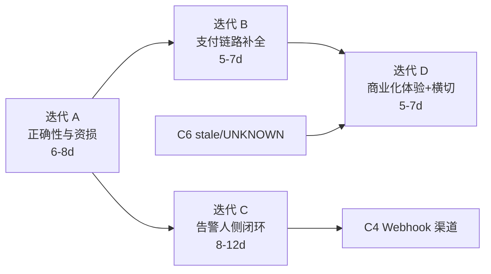

# 006：下一阶段开发计划（基于闭环审计）

> 状态：历史路线图。2026-10-30：007正确性、008降级宽限与邮件、009支付补偿、010 C5/C6已有实现；011进入可用性收尾，本轮已补本地数据库与业务回归。当前状态与边界见 `plans/README.md`、`plans/011-release-readiness.md`，下文保留原审计事实，不再按旧缺口重复排期。
> 输入：对 `master`（`c7980a4`）当前工作树的只读审计，覆盖 `src/modules/**` 30 个业务模块、`prisma/schema.prisma`、`docs/**`、`plans/001-005`、`test/**` 与 `probes/agent`。
> 基线：`pnpm type-check` 通过；工作树已有未提交改动（`Dockerfile`、`.dockerignore`、`package.json` 依赖分层、`pnpm-lock.yaml`、未跟踪 `scripts/notify.json`）与本计划无关，本计划不动它们。
> 本文件只描述**下一阶段要做什么**，不复述已有设计；设计与验收契约仍以 `plans/001-005`、`docs/design/*` 为准。

---

## 1. 结论摘要

四条业务链的**功能骨架都已闭合**，缺口集中在「闭环末端的运营能力」和「与钱、与租户隔离相关的正确性」上：

1. **租户协作链**（注册 → 建组织 → 邀请 → 项目/任务/评论/附件 → 通知 → 审计）已闭环；断点是注册非原子、邀请不可重发、评论无编辑历史、附件无扫描与存储配额。
2. **监控可观测链**（调度 → 探针执行 → 结果入库 → 状态聚合 → 规则求值 → 告警事件 → 渠道投递 → 状态页）核心闭环扎实（幂等、水位、outbox、租约、投票口径均有实现与单测）；但**告警的"人"侧完全缺失**：没有告警事件列表端点、没有确认/关闭、没有静默期、没有通用 Webhook，事件状态机只有 `ongoing/resolved`。
3. **商业化链**（套餐 → 订阅栈 → 订单 → 支付 → 退款）支付与退款主流程可用，但**收钱安全有三处硬缺口**：回调不核对金额、无渠道查单补偿、已取消订单可被回调复活；订阅**没有退订端点**（`Subscription.autoRenew` 是死字段）。
4. **平台运营链**（admin / settings / tickets / developer-api）完成度最高，tickets 代码与 e2e 均已闭环。

另有一项**必须立刻修**的跨租户越权（审计日志查询可越租户）与若干横切加固项（`/metrics` 无鉴权、Redis 硬单点、cron 吞异常）。

并且发现**文档与代码状态漂移**：`plans/002`（项目级授权）、`plans/004`（状态页热力图）、`plans/005`（工单）三份文档写着"未实施/草案"，实际代码已实施并有测试；`docs/proposals/alipay-payment-integration.md` 仍写"提案，未实施"。这会让后续排期基于错误前提，应作为低成本项随第一阶段一起修正。

---

## 2. 闭环评估矩阵

| 业务链 | 完成度 | 已闭环的部分（证据） | 闭环断点 |
|---|---|---|---|
| 租户与协作 | ~85% | 注册→OTP→`provisionForUser` 建组织+首项目+FREE 订阅（`organizations/organization-provisioning.ts:59-90`）；邀请→接受（`invitations/*`）；任务/子任务/依赖/关注者/活动时间线（`tasks/*`）；SSE+站内+邮件通知（`notifications/*`）；审计拦截器（`common/interceptors/audit-log.interceptor.ts`） | 注册非原子；邀请无重发；评论仅两级无编辑历史；附件无病毒扫描/存储配额；`labels`/`audit-logs`/`users` 零测试 |
| 监控可观测 | ~80% | 10s 扫描 + BullMQ 去重（`checker/checker.service.ts:332-403`）；`reportId` 幂等（`probes/probes.service.ts:583-618`）；`CheckLog` 一 round 一行 + 水位 + 乱序丢弃（`state/state.service.ts:236-299`、`:447-522`）；规则求值双跑（`:1175`、`:720`）；`AlertDelivery` durable outbox + 租约 + 3 次重试（`notifier/*`）；公开状态页 + 多级缓存 + ETag（`status-pages/*`） | 告警事件无列表/ACK/静默（`alert-events.controller.ts` 仅 `retry` 一个路由）；无 WEBHOOK/SMS 渠道（`schema.prisma:947-953`）；无 stale→UNKNOWN；HTTP/TCP/DNS 无 SSRF 阻断；告警表无保留策略 |
| 商业化 | ~70% | 档位定价与订阅栈（`shared/subscription/effective-plan.service.ts:67-244`）；升级冻结/降级排队/续费延长（`billing/payment/payment-settlement.ts:154-266`）；到期 sweep（`billing/subscription/subscription-expiry.service.ts`）；退款政策纯函数 + 单事务回收权益（`refund/refund-policy.ts`、`refund.service.ts:312-378`、`:660-722`）；虚拟支付最完整（含金额核对与 `query_order` 复核） | 微信 V3/支付宝回调不核对金额（`payment/payment.service.ts:120-155`）；无查单补偿（`wechat-pay.client.ts:130`、`closeTransaction` 零调用）；`CANCELLED` 订单可被回调复活（`payment-settlement.ts:54-57`）；无退订端点；配额断言在事务外（`monitors.service.ts:105-138` 等）；`PaymentStatus.FAILED` 从不写入 |
| 平台运营 | ~90% | admin 8 子域（`modules/admin/*`）；settings 9 分组 30s TTL 热加载（`settings/*`）；tickets 用户端 6 + 平台端 9 + e2e（`tickets/*`、`admin/tickets/*`、`test/tickets.e2e-spec.ts`）；developer-api 7 scope + 具名限流（`developer-api/*`） | 文档状态漂移（002/004/005/alipay proposal）；`/metrics` 无鉴权；无 Sentry/OTel；cron 异常吞掉无告警 |
| 安全与隔离 | ~75% | 双轨 guard 落地清单清晰（协作域已整体迁到 `ProjectAccessGuard`）；2FA 三表 + 6 端点；微信 OAuth（`UserIdentity`）；探针缺省吊销与平滑轮换（`probes.service.ts:972-1097`）；refresh token 轮换 | **审计日志跨租户越权**（`audit-logs.service.ts:50-53` 的 `organizationId ?? orgId`）；无会话/设备管理；无 step-up 二次校验 |

---

## 3. 缺口清单（按处置优先级）

### P0 — 阻断上线，必须先修

| # | 缺口 | 证据 | 影响 |
|---|---|---|---|
| P0-1 | 审计日志查询可用 query 参数覆盖路径租户：`where.organizationId = organizationId ?? orgId`，任意租户成员可读他租户日志 | `src/modules/audit-logs/audit-logs.service.ts:50-53`、`dto/query-audit-logs.dto.ts:24` | 跨租户数据泄露，多租户承诺失效 |
| P0-2 | 微信 V3 与支付宝支付回调均不核对实付金额 | `billing/payment/payment.service.ts:120-155`（`total_amount` 已在 `alipay-payment.service.ts:149` 解析但未比对） | 少付/改价可发货，直接资损 |
| P0-3 | 本地已 `CANCELLED` 的订单可被迟到的支付回调改回 `PAID` 并激活订阅（无 `order.status` 前置校验） | `payment.service.ts:120-189` + `payment-settlement.ts:54-57` | 超时关单形同虚设，账实不符 |
| P0-4 | 无支付查单补偿与渠道关单：回调丢失即订单永久 `PENDING`，已发出的 prepay 无法关闭 | `infra/wechat/pay/wechat-pay.client.ts:130,139` 零调用者；`infra/alipay/*.client.ts` 无 `trade.query`；`cron/jobs/order-expiry.service.ts:27-44` 只关本地 | 订单长期悬挂，需人工对账 |
| P0-5 | 配额断言在事务外，并发可突破上限 | `monitors/monitors.service.ts:105-138`、`probes/probes.service.ts:137-138`、`notifier/notification-channels.service.ts:20`、`developer-api/credentials/api-credentials.service.ts:49` | 付费墙被并发绕过 |
| P0-6 | HTTP/TCP/DNS 检查器无内网地址阻断（仅 PING 与应用类协议有） | `checker/checkers/http.checker.ts` 无 `BlockList`；对照 `ping.checker.ts:11-20`、`application-runtime.ts:41-85` | 租户可把平台当内网探测器/访问云元数据 |
| P0-7 | `/metrics` 由 middleware 直接暴露，无鉴权 | `infra/observability/metrics/metrics.middleware.ts:7-12`、`app.module.ts:134` | 内部指标外泄 |
| P0-8 | 文档状态漂移：`plans/002`、`plans/004`、`plans/005` 标"未实施/草案"，`docs/proposals/alipay-payment-integration.md` 标"未实施" | 各文档首行；对照 `test/project-access/*`、`status-pages.service.ts:263`、`test/tickets.e2e-spec.ts` | 排期基于错误前提 |

### P1 — 影响产品可用性（下一阶段主体）

| # | 缺口 | 证据 |
|---|---|---|
| P1-1 | 告警事件没有列表/详情/确认/关闭端点，前端无法做告警页 | `alert-events/alert-events.controller.ts` 仅 `POST .../:deliveryId/retry`；事件只能从 dashboard/insights 各取 ≤20 条 |
| P1-2 | `AlertEvent` 状态机只有 `ongoing/resolved`，无 ACK、无认领、无静默期/维护窗口 | `schema.prisma:1420`、`alert-events.service.ts:222-281` |
| P1-3 | 通知渠道只有 5 种，无通用 `WEBHOOK`、无 `SMS` | `schema.prisma:947-953`、`notifier/notifier.service.ts:67-73` |
| P1-4 | 无「长时间无观测 → UNKNOWN/NO_DATA」判定；扫描停摆或探针全掉线时状态永久停在旧值 | `state/state.service.ts:168-190`（无时间维度），全仓无 stale sweep |
| P1-5 | `alert_events`、`alert_deliveries`、`notification_logs` 无保留策略 | `cron/jobs/monitor-data-cleanup.service.ts:30-46` 只清 3 张表 + history |
| P1-6 | 投递死信无告警，只能人工 retry | `notifier/notifier.service.ts:407-419`、`admin` 无死信视图 |
| P1-7 | 订阅无退订/取消端点，`autoRenew` 是死字段 | `billing/subscription/subscription.controller.ts` 仅 `@Get()`；`schema.prisma:1618` 无读写 |
| P1-8 | 降级后的超额对用户不可见（`checkOverLimit` 零调用者，`GET /quota` 无 `overLimit`） | `shared/quota/quota.service.ts:273-290` |
| P1-9 | 状态页/项目数/PAT 数量无配额 | `quota.service.ts` 与 `schema.prisma` 均无字段；`developer-api/credentials/api-credentials.service.ts:216` |
| P1-10 | 到期扫描每次全表拉取启用监控，靠应用层过滤 interval | `checker/checker.service.ts:332-343` |
| P1-11 | Redis 是硬单点：启动即 `connect`+`ping` 无容错，全部队列与扫描 tick 依赖 | `infra/redis/redis.service.ts:30-35`、`infra/queue/queues.module.ts:19-24` |
| P1-12 | admin `mark-paid` 制造「订单 PAID 但无订阅」，无补建工具 | `admin/orders/admin-orders.service.ts:100-113` |

### P2 — 可延后（不在本阶段主线）

- 评论编辑历史与三级以上嵌套；附件病毒扫描与存储配额。
- 会话/设备管理、敏感操作 step-up、微信登录用户开 2FA。
- 监控区域亲和（`Monitor` 无 region，分配只看负载）、探针最低版本准入（无 `agentVersion`）、探针侧只支持 HTTP/TCP。
- 监控报表与定时通知（`docs/proposals/monitoring-reports.md` 仍在提案态）。
- 多次部分退款、发票红冲、分账（`docs/proposals/refund-integration.md:7,19-24` 已明示不做）。
- 死代码清理：`StateService.record()`、`NotifierService.notifyTransition()/shouldNotify()`、`MONITOR_TRANSITION_JOB` 与 `lastNotifiedStatus` 字段。

---

## 4. 下一阶段计划（4 个迭代）

排序依据：**资损/越权 > 产品可用性 > 体验**。每个迭代独立可交付、可单独上线。

### 迭代 A：正确性与资损收口（约 6~8 人日）

| 任务 | 落点 | 验收口径 |
|---|---|---|
| A1 修审计日志越权 | 删除 `QueryAuditLogsDto.organizationId`，`where.organizationId` 恒取路径 `orgId`；同类模式全仓扫一遍（`grep "?? orgId"`） | 新增单测：以 org-A 成员身份带 `organizationId=B` 查询，返回 A 的数据或 400，且不返回 B 任何行 |
| A2 支付回调金额核对 | `payment.service.ts` 在结算前比对 `callback.amount` 与 `payment.amount`（微信分/支付宝元分换算），不一致则记 `PaymentStatus.FAILED` + 告警日志 + 返回失败 | 单测：金额不符不激活订阅、订单不置 PAID；金额一致走原有幂等路径 |
| A3 订单状态前置校验 | `handleCallback` 增加 `order.status` 准入（`PENDING/PAID` 可结算，`CANCELLED/REFUNDED` 拒绝并落异常日志） | 单测：已取消订单收到成功回调 → 不改状态、不激活订阅、返回失败 |
| A4 `PaymentStatus.FAILED` 落库 | 回调失败、渠道返回失败、查单失败三条路径统一写 FAILED（当前恒为 PENDING） | 单测覆盖三条路径；后台可按 FAILED 筛单 |
| A5 `mark-paid` 一致性 | 抽取 `PaymentSettlementService.settlePaidOrder` 供 admin 复用；后台手工置 PAID 时同事务补建/顺延订阅 | 单测：手工 mark-paid 后 `getEffectivePlan` 立即生效 |
| A6 配额并发保护 | `QuotaService.assertCanCreate/assertMonitorPolicy` 接受 `tx` 参数；monitors/probes/channels/apiKeys/statusPages/PAT 断言移入事务并对 `Organization` 行加锁（成员配额已是此模式，见 `invitations.service.ts:428,526`） | 并发单测：同时发起 N+1 个创建，恰好 N 个成功；超额返回 403 `QUOTA_EXCEEDED` |
| A7 SSRF 阻断 | 抽出 `network/address-guard.ts`（复用 `ping.checker.ts:11-20` 的 BlockList + DNS 解析 pin），HTTP/TCP/DNS 检查器统一接入；HTTP 重定向逐跳校验 | 单测：`http://127.0.0.1`、`10.0.0.1`、`169.254.169.254`、解析到内网的域名均被拒；公网目标不受影响 |
| A8 `/metrics` 鉴权 | 改为 `MetricsController`：`METRICS_TOKEN` bearer 或来源 IP 白名单（默认仅内网），未配置时禁用端点 | 无凭据 401/403；带凭据 200；未配置时 404 |
| A9 文档真相修复 | `plans/002/004/005` 状态改为"已实施"并标注验证方式；`alipay-payment-integration.md` 更新为"已实施"；`docs/design/billing.md` 补 `PlanTerm`、退款、虚拟支付、对账 cron | `docs/README.md` 索引与实际一致；无文档再声称已实现功能"未实施" |

**迭代 A 出口**：`pnpm type-check && pnpm lint && pnpm test` 全绿；新增 8 组回归单测；一份「跨租户越权与支付资损」修复说明（可并入 PR 描述）。

### 迭代 B：支付链路补全（约 5~7 人日，依赖 A2-A5）

> 2026-10-29：B1–B5 代码与自动化验证已完成，见 [009 实施记录](009-payment-chain-completion.md)。全量单测 176 suites / 2400 tests、离线 HTTP 全链 3 cases 通过；真实 PostgreSQL 迁移 / 并发验收与真实渠道联调未执行（数据库验收按用户要求跳过）。前端契约见 `docs/api/payment-reconciliation.md`。

| 任务 | 落点 | 验收口径 |
|---|---|---|
| B1 微信 V3 查单补偿 | 调用 `wechat-pay.client.ts:130 queryTransaction`，新增 `*/5` cron（与 `refund-reconcile.service.ts` 同构，带 lease 防重） | 手工丢回调的订单在 ≤5 分钟内自动结算；重复扫描幂等 |
| B2 支付宝查单补偿 | 新增 `alipay.trade.query` 客户端方法 + 同一 sweep 内分通道处理 | 同上 |
| B3 渠道关单 | `order-expiry.service.ts` 取消前调用微信 `closeTransaction` / 支付宝 `trade.close`，失败仅告警不阻塞本地取消 | 取消后渠道侧不再可支付；关单失败记录可观测 |
| B4 `PaymentAttempt` 普及到 V3/支付宝 | 每次发起支付新建 attempt 并以其单号作 `out_trade_no`（对齐虚拟支付 `wechat-virtual-payment.service.ts:235-246`），避免复用 `Order.orderNo` 导致的关单后不可重下 | 同一订单可多次发起支付；每次成功只结算一次 |
| B5 退款金额核对 | `wechat-payment.service.ts:157-164` 增加退款金额比对 | 金额不符的退款回调不推进状态 |

**迭代 B 出口**：支付/订单/退款三域 e2e 打通（新建 `test/billing-payment.e2e-spec.ts`，覆盖 下单→回调→结算→退款→对账 一条完整链）。

### 迭代 C：监控告警的"人"侧闭环（约 8~12 人日，可与 B 并行）

| 任务 | 落点 | 验收口径 |
|---|---|---|
| C1 告警事件查询端点 | 已实现：项目事件列表/详情、关联投递及尝试日志分页，按 kind/status/level/开始时间/监控过滤；失败重试复用原端点 | ProjectAccessGuard + 事务内鉴权；安全投影、历史与权限回归，前端契约见 `docs/api/alert-event-investigation.md`、实施见 012 |
| C2 确认与关闭 | `AlertEvent.status` 扩为 `ONGOING/ACKED/RESOLVED`，新增 `ACKED` 迁移；`POST .../alert-events/:id/ack`（记录 `ackedBy/ackedAt`）；自动恢复仍由求值写 `RESOLVED`，ACK 不影响判定 | 单测：ACK 后新异常不重复开启新事件；恢复后状态为 RESOLVED |
| C3 静默与维护窗口 | 新模型 `MonitorSilence`（scope: monitor/项目/全部，`startsAt/endsAt/reason/createdBy`），结算与投递两处判断静默：静默期不新建事件、不投递，事件落 `suppressedReason` | 单测：静默期内异常不产生投递；静默结束后的持续异常立即开启事件 |
| C4 通用 Webhook 渠道 | `NotificationChannelType` 增 `WEBHOOK`，支持自定义 header 与 HMAC-SHA256 签名（`X-Beacon-Signature: t=..,v1=..`）；payload 复用 `channel-message.ts` 结构 | 单测 + 本地 server 接收验证；签名可被外部独立验证 |
| C5 死信可见 | 已实现：`GET /api/admin/alert-deliveries?status=FAILED` + 每日组织 OWNER/ADMIN 站内及邮件汇总（复用 `NotificationDelivery`），保留项目人工 retry | 终态 FAILED 可达；后台可筛选重试；离线 HTTP 验证通过 |
| C6 stale→UNKNOWN | 已实现：每分钟 sweep，独立有效观测时钟 `lastEffectiveObservationAt` 超过 `max(3×interval, 10min)` → UNKNOWN + 单次 NO_DATA；创建/编辑/恢复给予调度宽限 | 离线生命周期测试覆盖停摆、恢复、旧结果拦截和 SSL 独立告警；真实数据库验收按要求跳过 |
| C7 保留策略扩展 | `monitor-data-cleanup.service.ts` 的 `RETENTION_TARGETS` 增 `alert_events`(180d)/`alert_deliveries`(90d)/`notification_logs`(90d) | 单测沿用现有分批删除 harness |
| C8 扫描查询下推 | 到期判定改为 SQL 侧条件（`lastLocalCheckAt` + interval 表达式或冗余 `nextCheckAt` 列 + 索引），保留应用层二次校验 | 压测/EXPLAIN 记录写入 `docs/guides/monitoring-operations.md` |

**迭代 C 出口**：`test/alerting.e2e-spec.ts` 覆盖 检查→结算→事件→投递→ACK→恢复 全链（当前该拼接点零 e2e，是最大测试空洞）。

### 迭代 D：商业化体验与横切加固（约 5~7 人日）

| 任务 | 落点 | 验收口径 |
|---|---|---|
| D1 退订/关自动续费 | `PATCH /organizations/:orgId/subscription`：`autoRenew` 落地（到期不自动续，语义为「不生成新订单」）+ 立即退订走既有退款流程 | 单测：关自动续费后到期 sweep 不产生续费订单；重开恢复 |
| D2 超额可见 | `GET /quota` 增 `overLimit`（接 `checkOverLimit`）；资源创建返回体带 `upgradeUrl` 提示位 | 单测：降级后配额视图 `overLimit=true` |
| D3 试用期 | `Plan.trialDays` 或 `PlanTerm` 级 trial；`provisionForUser` 与首单结算支持 trial 订阅（`Subscription.status=TRIAL` 或独立字段），到期转 FREE | 单测：试用到期回落 FREE；试用期内升级按差价结算 |
| D4 订单金额脱敏 | `OrderEntity` 对非 `ADMIN` 角色隐藏金额与单号细节 | 单测：MEMBER 与 ADMIN 视图字段差异 |
| D5 Redis 容错 | `RedisService.onModuleInit` 失败降级：禁用队列/扫描 job 并暴露 health 状态 `degraded`，而不是启动即崩 | 单测 + `GET /health/ready` 在 Redis 断开时返回 degraded 而非 500 |
| D6 cron 异常可见 | 统一 job 包装记录失败次数与最后错误，失败即写告警日志（后续可接 C4 的 Webhook 渠道） | 单测：job 抛错被记录且不影响下次调度 |
| D7 测试补齐 | `notifications-*` 集成测试接入 `package.json` 脚本；`labels`/`audit-logs`/`users` 补基础 spec；钉钉/飞书/企微 sender 与两种签名补单测 | CI 中可执行；签名用例固化 docs 中的样例 |

**迭代 D 出口**：`pnpm test` 全绿且新增脚本被 CI 覆盖；`docs/design/billing.md` 与实现再次对齐。

---

## 5. 顺序与依赖

- A 是硬前置：A2/A3 不修，B 的自动结算会把错误订单也结算掉。
- B 与 C 无代码耦合，可并行两路或前后串行（取决于人力）。
- D 中 D1/D3 依赖 A5（结算路径统一）与 B4（单号机制）。

**总计**：约 24~34 人日；单人顺序执行约 6~7 周，双人并行约 4 周。

---

## 6. 本阶段明确不做

- 不做监控报表/定时报表（`docs/proposals/monitoring-reports.md` 保持提案）。
- 不做区域亲和、探针最低版本准入、探针侧多协议扩展。
- 不做多次部分退款、发票、分账、跨境。
- 不做状态页自定义域名/订阅者/访问控制（等 C 落地后单独立项）。
- 不重构双轨 guard（协作域已在新轨，`docs/AUTHORIZATION.md` 只需更新描述，不迁移代码）。

---

## 7. 待决策的开放问题

1. **试用期与降级策略**是否需要（D3）：涉及定价与运营口径，需要产品确认；不确认则 D3 顺延。
2. **Webhook 渠道**是否需要出站签名规范先行对齐外部（C4）：若有客户已在对接，需要先定 payload 与签名契约。
3. **`/metrics` 鉴权方式**：内网 IP 白名单 vs bearer token（A8），取决于部署形态（K8s 内网抓取则白名单更简单）。
4. **告警静默粒度**（C3）：仅按监控静默，还是需要项目级「全局维护窗口」。
5. 监控事件保留期（C7）：180 天是否满足合规/审计诉求。
